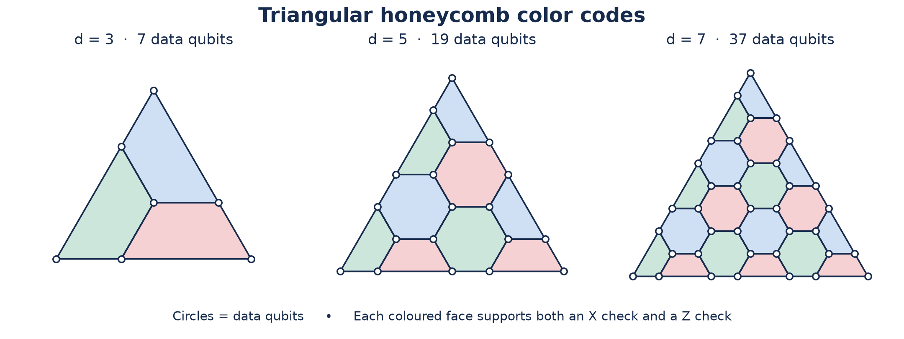
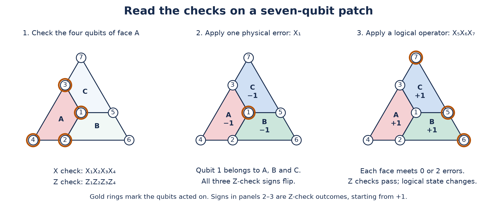
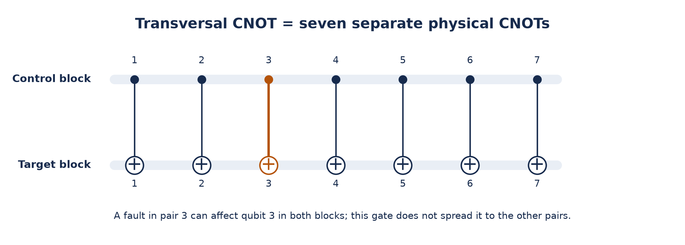

# Color codes: checks, transversal gates, and the Helios experiment

Last updated: 2026-10-27

## Two checks on each face

A 2D **color code** puts data qubits on the vertices of a lattice whose faces can be coloured red, green and blue, with neighbouring faces having different colours. Three edges meet at each bulk vertex. The colours describe geometry, not different physical states of an ion.

**Figure 1.** Larger patches protect one logical qubit using more data qubits. Each coloured region is one face, and every circle is a data qubit. Measurement helpers are omitted. The triangular drawing describes the code connections; ions need not occupy these positions in the trap.

On each face $f$, measure both

$$
S_f^X=\prod_{i\in f}X_i,\qquad S_f^Z=\prod_{i\in f}Z_i.
$$

For a four-qubit face these are $X_1X_2X_3X_4$ and $Z_1Z_2Z_3Z_4$. In the triangular honeycomb family, bulk faces have six qubits and truncated boundary faces have four. These are **CSS stabilizer codes**: separate all-$X$ and all-$Z$ checks define the protected subspace through their $+1$ eigenvalues.

The checks commute because their supports overlap on an even number of qubits. Exchanging $X$ and $Z$ on one shared qubit gives a minus sign; an even number of such signs cancels. This applies both to the two checks on the same even-sized face and to checks on adjacent faces sharing an edge.

A physical $X_i$ anticommutes with every $Z$ check containing qubit $i$, reversing those check signs while leaving the $X$ checks unchanged. A bulk vertex touches three faces, so one $X$ error flips three neighbouring $Z$ checks. A $Z_i$ error similarly flips neighbouring $X$ checks. These signs reveal error information without revealing the unknown logical amplitudes. Repeated, noisy check measurements require a [decoder using the measurement history](../decoders/README.md#from-syndrome-to-correction).

Color codes were introduced by Bombín and Martin-Delgado in [*Topological Quantum Distillation* (2006)](https://arxiv.org/abs/quant-ph/0605138). Quantinuum implemented an established code family.

## A seven-qubit example

The smallest triangular color code is the Steane $[[7,1,3]]$ code: seven data qubits encode one logical qubit with distance three. One valid numbering gives these six independent checks:

| Face | $X$ check | $Z$ check |
| --- | --- | --- |
| A | $X_1X_2X_3X_4$ | $Z_1Z_2Z_3Z_4$ |
| B | $X_1X_2X_5X_6$ | $Z_1Z_2Z_5Z_6$ |
| C | $X_1X_3X_5X_7$ | $Z_1Z_3Z_5Z_7$ |

**Figure 2.** The same patch shows a face check, a detectable single-qubit error and an undetectable logical operator. Faces A and B share qubits 1 and 2, so their opposite-type checks overlap twice and commute.

Each face has four qubits; each pair shares two. Six independent constraints leave a two-dimensional code space, enough for one logical qubit.

Write a syndrome bit as 1 when a check sign flips. Reading the $Z$ checks in order A, B, C, the errors $X_1,\ldots,X_7$ produce **111, 110, 101, 100, 011, 010, 001**. Thus ideal checks distinguish every single-qubit $X$ error. The $X$ checks provide the corresponding information for $Z$ errors; a $Y$ error affects both sets.

Logical Pauli representatives are

$$
\bar X=X_1X_2X_3X_4X_5X_6X_7,\qquad
\bar Z=Z_1Z_2Z_3Z_4Z_5Z_6Z_7.
$$

They commute with all checks and anticommute with each other. Multiplying $\bar X$ by face A's $X$ check gives the equivalent representative $X_5X_6X_7$. It changes the logical information without changing any check sign. No one- or two-qubit Pauli has that property, so the distance is three. The ability to correct one error assumes suitable syndrome information; noisy extraction circuits need their own fault-tolerant design.

## What makes the gates special

A **transversal gate** acts separately on each qubit of a block, or on corresponding qubit pairs across blocks. Suitable triangular color codes support a full **Clifford** gate set this way. Clifford gates map Pauli operators to Pauli operators under conjugation and can be generated by $H$, $S$ and CNOT. The phase gate $S$ leaves $|0\rangle$ unchanged and multiplies $|1\rangle$ by $i$.

- **Hadamard:** $HXH=Z$ and $HZH=X$. Applying $H$ to every data qubit exchanges each face's $X$ and $Z$ checks, and exchanges $\bar X$ with $\bar Z$. It therefore implements logical $H$.
- **Phase:** $SXS^\dagger=Y=iXZ$. Physical phase gates must also preserve the check signs. Applying the same $S$ everywhere is insufficient for a six-qubit face, because $i^6=-1$. A honeycomb patch is bipartite: its vertices split into two subsets so every edge joins different subsets. Apply $S$ on one subset and $S^\dagger$ on the other. Each face has equal numbers of the two, cancelling the unwanted phase. The pattern implements logical $S$ or $S^\dagger$, with the choice fixed by its action on the logical operators. In the seven-qubit numbering above, $S$ on 1, 4, 6, 7 and $S^\dagger$ on 2, 3, 5 implements logical $S$.
- **CNOT:** apply physical CNOTs from qubit $i$ in the control block to qubit $i$ in an identical target block. Since $X_c\mapsto X_cX_t$ and $Z_t\mapsto Z_cZ_t$, the logical operators transform exactly as for a logical CNOT, while stabilizers map to stabilizers.

**Figure 3.** One logical CNOT acts through corresponding physical qubit pairs. The rows group qubits by code block; each vertical line is a separate CNOT, with a control dot and a target plus sign.

For a pairwise CNOT, a fault may affect both blocks, but each qubit participates in just one pair. It cannot fan out through that gate into several qubits of either block. This limits error propagation; physical gates can still fail and repeated correction remains necessary. The [foundational construction](https://arxiv.org/html/quant-ph/0605138v3) explains the lattice conditions behind these gates.

The benefit is a simple implementation of many logical operations. Surface codes also implement Clifford gates, using methods including [lattice surgery](../../surface_code.ipynb), patch transformations and suitable transversal operations. Color codes offer a different balance: fewer data qubits at a given distance and convenient Clifford gates, but more demanding check circuits and decoding. A single bulk error's three-check signature already goes beyond the simplest two-endpoint matching picture. Hardware connectivity, physical error rates, extraction faults and routing costs determine which balance works best.

The full Clifford group does **not** provide arbitrary quantum computation. In particular, this 2D code does not supply a transversal $T$ gate. This gate leaves $|0\rangle$ unchanged and multiplies $|1\rangle$ by $e^{i\pi/4}$. Universal computation needs an additional resource, such as a prepared **magic state** consumed in a measurement-based $T$-gate protocol.

## What Quantinuum measured in October 2026

The [Lavasani et al. preprint, submitted 16 October 2026](https://arxiv.org/html/2610.24077v1), tested triangular honeycomb codes on the Helios trapped-ion processor. Their parameters are

$$
[[n,1,d]],\qquad n=\frac{3d^2+1}{4},\qquad d\text{ odd}.
$$

Here $n$ counts data qubits, while syndrome extraction needs additional helper qubits. For comparison, a standard rotated surface-code patch has $d^2$ data qubits. The smaller color-code data count alone does not establish a smaller total algorithm cost.

For memory, the experiment prepared each of the six logical Pauli eigenstates ($|0\rangle$, $|1\rangle$, $|\pm\rangle$, $|\pm i\rangle$), performed 20 correction cycles, then measured in the corresponding logical basis. The primary Tesseract-decoded estimates were:

| Distance | Data qubits | Total qubits per memory experiment | Logical error per cycle |
| --- | --- | --- | --- |
| 3 | 7 | 13 | $5.5^{+0.4}_{-0.4}\times10^{-4}$ |
| 5 | 19 | 37 | $3.8^{+1}_{-0.8}\times10^{-5}$ |
| 7 | 37 | 73 | $5^{+4}_{-2}\times10^{-6}$ |

These are Table 1 estimates with 68% Wilson confidence intervals. The fitted suppression for a distance increase of two was $\Lambda=12^{+3}_{-2}$; the individual adjacent ratios need not equal 12. This is evidence that, for these circuits and hardware conditions, extra protection outweighed the extra opportunities for faults.

At distance seven there were **3 logical failures in 29,000 runs**, each containing 20 cycles. The paper estimates the per-cycle rate as

$$
p_L\approx\frac{3/29000}{20.5}\approx5.0\times10^{-6},
$$

where the extra half-cycle accounts approximately for state preparation. Three failures leave broad statistical uncertainty. This was not one continuous million-round computation; the [company's “one million operations” framing](https://www.quantinuum.com/blog/quantinuum-closes-in-on-one-million-error-free-operations) extrapolates from a small per-cycle error estimate.

The computation test was **two-qubit Clifford randomized benchmarking**: random logical Cliffords followed by an inverse sequence, so ideal output is known. It tested distances three and five; two distance-seven blocks exceeded the hardware's qubit capacity. At distance five, the fitted error was $7^{+3}_{-3}\times10^{-5}$ **per logical two-qubit Clifford**, with correction after every seven logical Cliffords. This is a compiled benchmark operation, not a bare physical CNOT or a memory cycle. Its improved performance with distance supports this tested Clifford workload, rather than establishing arbitrary universal computation. [Paper, Clifford randomized benchmarking](https://arxiv.org/html/2610.24077v1)

## Why this is a useful hardware match

Flexible ion connectivity makes the corresponding-qubit interactions for transversal CNOTs accessible and allows the extraction schedule to rearrange qubit roles. That flexibility has finite transport and cooling costs. The paper's simulated error budget identifies transport-related memory errors as a substantial remaining contribution.

**Leakage** means an ion has left the two levels used as $|0\rangle$ and $|1\rangle$. A leaked ion can keep disturbing partners over successive gates, defeating the assumption that one fault remains a short-lived local error. The experiment combines two remedies:

1. **Optical repumping** moves leaked population back into the computational levels. It does not recover the original unknown state or identify a flagged erasure; it converts much of the persistent leakage into errors ordinary qubit QEC can handle.
2. **SWAP-superdense syndrome extraction** transfers the data roles onto fresh helper qubits, allowing the previous data carriers to be measured and reset. A rotating schedule refreshes every data carrier within three cycles. This removes leakage that survives repumping.

The extraction circuit's corrective bookkeeping can be tracked as a **Pauli frame**, a classical record used to interpret later operations and outcomes. Neither the decoder nor repumping learns the unknown logical state. These complementary leakage controls make the code's mathematical protection more effective on real ions. [Paper, leakage reduction](https://arxiv.org/html/2610.24077v1)

## Decoding and the remaining computation gap

All decoding in this study was **offline**. The primary decoder, **Tesseract**, uses A* search for a most likely error explanation of a Stim detector error model. **Frontier** uses pruned dynamic programming. A convolutional neural network and a round-token transformer were trained on emulator-generated data and applied to hardware records without further fine-tuning. The [decoder notes](../decoders/README.md#beyond-matching-and-what-companies-build) explain how these approaches differ from matching and belief propagation.

Streaming timing tests supplied recorded syndromes one round at a time. Neural timings measured isolated computation on an NVIDIA H100 GPU; Frontier's WebAssembly timings ran on a laptop. These tests support feasibility, but exclude the full communication and control path needed for live feedback. [Paper, decoding methodology](https://arxiv.org/html/2610.24077v1)

The practical promise is a measured combination of compact blocks, convenient protected gates and strong distance scaling on compatible hardware. What remains is to combine many interacting blocks, live decoding and feedforward, reliable magic-state supply and $T$ injection, and longer circuits demonstrating below-threshold full Clifford+$T$ execution. Total resources must include helpers, routing, time and magic-state production. The company's Apollo 2029 target is a [roadmap](https://www.quantinuum.com/blog/quantinuum-closes-in-on-one-million-error-free-operations), not an outcome established by this experiment.

This October color-code experiment is separate from the September Helix work already listed in the [qLDPC industry overview](../qldpc-codes/README.md#what-major-companies-are-doing); their reported error rates should not be combined.
