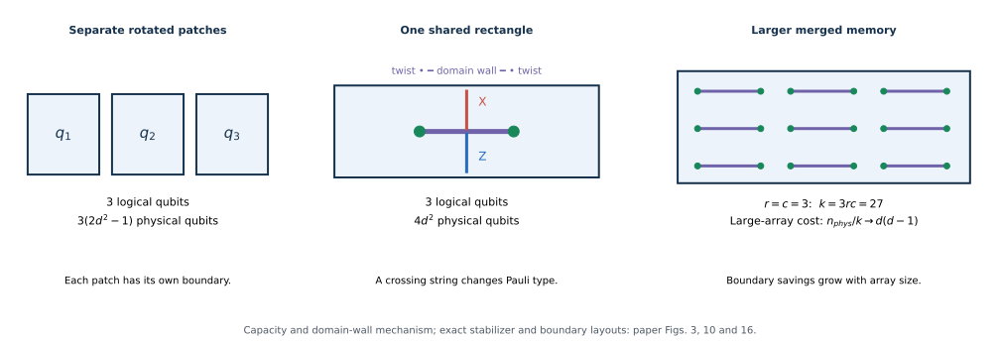

# A denser planar surface code

Last updated: 2026-10-19

Google Quantum AI's [*A Denser Planar Surface Code*, Low et al., arXiv:2605.30455v1](https://arxiv.org/abs/2605.30455v1) stores several logical qubits in a shared surface-code region. Twist defects let logical strings change between $X$ and $Z$, creating additional logical degrees of freedom; merging the surrounding patch boundaries then reduces duplicated boundary space. The practical advance is a short, local measurement circuit that makes this packing perform well in circuit-level memory simulations. A further increase from **yoking** is a projection with additional decoding and operation assumptions. [Paper, §§I.A.1 and III](https://arxiv.org/pdf/2605.30455v1#page=4)

## Separate rotated patches: what is being counted?

A distance-$d$ rotated surface-code patch stores one logical qubit using $d^2$ **data qubits**. Its $d^2-1$ independent stabilizers have dedicated **measurement qubits** in the usual extraction circuit, giving

$$
n_{\mathrm{phys}}=d^2+(d^2-1)=2d^2-1.
$$

For example, $d=5$ uses 25 data and 24 measurement qubits, or 49 physical qubits. Logical $\bar X$ and $\bar Z$ are strings that commute with all stabilizers and anticommute with each other. Their shortest nontrivial representatives have weight $d$. This is the separate-patch memory used in the [surface-code notebook](../../surface_code.ipynb). [Paper, Fig. 3 and §II](https://arxiv.org/pdf/2605.30455v1#page=5)

**Memory occupancy and computational layout are different costs.** A conventional lattice-surgery layout allocates a bounding box of $2(d+1)^2$ physical-qubit sites per patch to accommodate boundary checks and consistent merging. The paper reduces this box to $2d^2$ using a different schedule. Neither box includes every algorithmic ancilla, access hallway, routing region, or magic-state factory: these must still appear in a machine-level estimate. At $d=5$, the three counts are 49 occupied memory qubits, 72 sites in the conventional box, and 50 sites in the new compact box. [Paper, §II and Table I](https://arxiv.org/pdf/2605.30455v1#page=3)

Throughout this article, $n_{\mathrm{phys}}$ includes data and measurement qubits. This differs from the usual $n$ in stabilizer-code notation $[[n,k,d]]$, which counts data qubits only, as explained in the [qLDPC notes](../qldpc-codes/README.md#protection-and-encoding-efficiency).

## Twist defects: shared information rather than three isolated squares

In an ordinary surface-code bulk, checks are pure $X$ or pure $Z$. A **domain wall** changes how these two check types fit together. A logical string crossing the wall must exchange $X\leftrightarrow Z$ to keep commuting with the checks. In the excitation picture, the wall exchanges the two surface-code anyon types. Its endpoints are **twist defects**, with mixed-Pauli checks such as the weight-five $XXYZZ$ stabilizer. The $Y$ factor allows the local meeting of the two Pauli types. [Paper, §I.A.1 and §III, Fig. 10](https://arxiv.org/pdf/2605.30455v1#page=12)

A twist is not an additional physical data qubit or a logical qubit by itself. Twists and the junctions of $X$ and $Z$ boundaries change which strings and loops can exist without a syndrome. Some of these operators cannot be reduced to stabilizers. Choosing independent anticommuting pairs among them defines the extra logical qubits. In the paper's rectangle, mixed strings and a loop supply a basis of **three logical pairs** in one connected region. The logical qubits share physical data; assigning each one a disjoint subpatch would miss the mechanism. [Paper, Fig. 10, especially the displayed logical basis](https://arxiv.org/pdf/2605.30455v1#page=13)

*Capacity and domain-wall comparison based on paper Figs. 3, 10 and 16. The right panel groups repeated twist pairs; the actual dense code also has carefully shaped interior boundaries, shown in [Fig. 16](https://arxiv.org/pdf/2605.30455v1#page=19). Physical checks and spacings must follow those layouts.*

The rectangle occupies the footprint of two compact square patches, $4d^2$ physical qubits, while encoding three logical qubits. A larger array merges boundaries of these rectangles and saves more space. Twist spacing and boundary placement remain essential: strings between twists, strings to boundaries, and mixed $Y$ error paths can otherwise create short logical errors. Packing defects arbitrarily closely would sacrifice protection. [Paper, §§III.A.1–2](https://arxiv.org/pdf/2605.30455v1#page=16)

## Making twist measurements practical

### Reconstruct a high-weight stabilizer from gauge outcomes

Directly collecting a weight-five twist parity on one ancilla can require extra connections or a deeper circuit. The paper instead uses a **subsystem measurement construction**: measure smaller gauge operators, then combine the appropriate outcomes to recover the stabilizer. Gauge operators commute with the protected stabilizer group, but the gauge set need not commute internally. Their individual outcomes can therefore fluctuate even without an error. [Paper, §III and Table IV](https://arxiv.org/pdf/2605.30455v1#page=13)

For a compatible pair in the prescribed sequence, write the stabilizer as $S=G_aG_b$, absorbing any known sign into its definition. Outcomes $g_a,g_b\in\{+1,-1\}$ reconstruct $s=g_ag_b$. This does **not** mean multiplying arbitrary consecutive measurements of anticommuting operators. The sequence must preserve the needed parity information. The paper reconstructs each twist and rectangular domain-wall stabilizer from two gauge outcomes and adds a weight-two domain-wall component to maintain the required matchable detector structure. [Paper, §III and Table IV](https://arxiv.org/pdf/2605.30455v1#page=15)

A **detector** is a predictable parity of outcomes across the measurement circuit. Comparing reconstructed check information over time detects faults even though individual gauge outcomes are random. This is the detector-history viewpoint of the [decoder notes](../decoders/README.md#what-mwpm-matches), extended to the twist schedule.

### Four entangling layers, with carefully controlled propagation

The construction runs on a regular planar hexagonal interaction graph with nearest-neighbor degree three. Each cycle uses **four layers of two-qubit CX/CZ gates**, plus one reset and one measurement layer: six layers total. The schedule alternates between a sequence and its inverse, with reset and measurement exchanged. The locations and shapes of check supports change during the cycle; a static drawing of end-cycle stabilizers does not specify this circuit. Single-qubit Clifford changes can exchange CX/CZ or measurement-basis conventions. [Paper, Table IV and §III](https://arxiv.org/pdf/2605.30455v1#page=15)

A **hook error** occurs when one circuit fault spreads into a correlated data error through later gates. Gate order determines whether that error advances along a dangerous logical path. The short schedule avoids the extensive distance loss of earlier twist implementations, but “hook-free” is too strong without qualification: the six-layer construction loses one unit of distance for strings crossing the domain wall. An eight-layer alternative removes that loss. There are also diagonal $YY$ hook chains whose formal circuit distance is shorter than a single-data-error geometry suggests. [Paper, Table III and §III.A, Fig. 12](https://arxiv.org/pdf/2605.30455v1#page=14)

Under the paper's noise model, a particular two-qubit Pauli fault such as $YY$ has probability $p/15$. A dangerous chain requiring a specific sequence of these faults has fewer realizations and a smaller probability than many competing $X/Z$ chains. Thus a short formal error path need not dominate the sampled logical error rate. The authors exploit this measured suppression when positioning defects; it is a noise-dependent design choice. [Paper, §III.A and Fig. 12](https://arxiv.org/pdf/2605.30455v1#page=16)

### Decode the circuit, then compare performance

The memory benchmarks use Stim circuit-level Monte Carlo sampling and sparse-blossom **two-pass correlated minimum-weight perfect matching**. Correlation information matters when a single $Y$ or $YY$ fault produces several graph components; treating all components independently can misprice that fault. The [correlated-matching notes](../decoders/README.md#correlated-matching-let-one-edge-suggest-another) explain this distinction. The new twist construction retains efficient matching-based decoding despite its mixed-Pauli checks. [Paper, §I.A.1, §II and Table II](https://arxiv.org/pdf/2605.30455v1#page=4)

Keep three quantities separate:

| Quantity | What it establishes |
| --- | --- |
| Stabilizer-code distance | Smallest data-Pauli support implementing a nontrivial logical operation at a specified code slice. |
| Circuit-level distance | Smallest number of allowed circuit faults producing an undetected logical error, including propagated faults. |
| Decoded logical error rate | Failure probability for a specified circuit, noise model, decoder, duration and logical observable. |

The rectangle's parameter $d$ is an **effective-distance label defined by its height**, not a proof that every formal distance equals $d$. Its average logical error per round per logical qubit is approximately $3.5^{-d}/10$, close to the ordinary patch's dynamically updated, $Z$-top orientation. The optimized static-memory orientation has the better fit $4^{-d}/10$. Consequently, “similar surface-code performance” needs an orientation and decoder attached; geometric density at equal $d$ is not automatically density at equal failure probability. [Paper, §II.A.1 and §III.A.1, Figs. 6 and 13](https://arxiv.org/pdf/2605.30455v1#page=17)

## Where each density gain comes from

The baseline below is approximately $2d^2$ physical qubits per independent logical memory qubit, including measurement qubits. The exact occupied count is $2d^2-1$. These gains describe different comparison bases and should not be multiplied together.

| Reported gain | Mechanism and comparison basis | Assumptions and evidence |
| --- | --- | --- |
| **$1.5\times$** | Three logical qubits in a $4d^2$ rectangle rather than three separate $2d^2$ boxes: $3(2d^2)/(4d^2)=1.5$. | Equal effective size $d$; optimized twist/boundary positions. Circuit-level memory simulations support approximately ordinary dynamic-patch error scaling. With exact $2d^2-1$ memory occupancy, the ratio is $1.5-3/(4d^2)$. [§III.A.1, Fig. 13](https://arxiv.org/pdf/2605.30455v1#page=17) |
| **Approximately $2\times$** | Merge many rectangles to amortize boundaries. In a large array, physical qubits per logical qubit approach $d(d-1)$ instead of approximately $2d^2$. | Large row and column counts, equal effective $d$; finite boundaries add overhead. The ratio tends toward two as $d$ also grows. A 27-logical-qubit array is explicitly simulated. [§III.A.2, Fig. 16](https://arxiv.org/pdf/2605.30455v1#page=19) |
| **Up to $4.5\times$, projected** | Add an outer parity-check code so smaller inner patches can meet a target logical error rate. Fig. 11 compares optimized physical qubits per logical qubit at matched error targets against ordinary rotated memory using $p_L=4^{-d}/10$ and $2d^2$ boxes. | Large-block favorable regime; includes yoke and workspace costs in the layout enumeration. Depends on an ideal outer decoder, assumed access-operation errors, extrapolated fits and the $p=10^{-3}$ depolarizing model. It is the combined yoked-memory gain relative to ordinary memory. [Fig. 11 and §III.B](https://arxiv.org/pdf/2605.30455v1#page=14) |

For the unyoked dense layout, let $r$ be the number of rectangle rows and $c$ the number of rectangle columns. The paper gives

$$
k=3rc,\qquad
W=\frac{d+3}{2}+\frac{3c(d-1)}{2},\qquad
H=\frac{d-1}{2}+rd,\qquad
n_{\mathrm{phys}}=2WH.
$$

Hence $n_{\mathrm{phys}}/k\to d(d-1)$ as $r,c\to\infty$. This explains the boundary saving and its finite-size cost directly. The paper optimizes the rectangle for odd $d$; equivalent even-$d$ performance used later is an assumption. [Paper, Eqs. (3.1)–(3.2) and §III.A.1](https://arxiv.org/pdf/2605.30455v1#page=19)

### Yoking exchanges access time for smaller inner patches

For each column of an even number $n_{\mathrm{row}}$ of inner logical qubits, the outer $[[n_{\mathrm{row}},n_{\mathrm{row}}-2,2]]$ code checks $X^{\otimes n_{\mathrm{row}}}$ and $Z^{\otimes n_{\mathrm{row}}}$. The even column length makes these two checks commute. Two logical degrees of freedom per column become yoke overhead. These parities detect a single inner logical error, but do not by themselves identify its location. An outer decoder needs reliability information from the inner decoding; a proposed approach uses **complementary gaps**, comparing confidence in alternative logical explanations. A distance-two code alone does not guarantee correction of an arbitrary unknown single-qubit error. [Paper, §III.B](https://arxiv.org/pdf/2605.30455v1#page=20)

Dense memory also has correlated errors that flip two neighboring logical qubits in the same column and escape that column's parity check. The paper enumerates the leading distance-$d_{\mathrm{in}}$ and $3d_{\mathrm{in}}/2$ mechanisms and shows how information across three neighboring columns can distinguish them, **assuming correct localization of detectable faults and no distance-$2d_{\mathrm{in}}$ errors**. Filtering those correctable classes from simulated memory errors gives best-case residual scaling near twice the inner effective distance. This is evidence for the proposed decoder's information requirements, rather than an implemented outer-decoder benchmark. [Paper, Figs. 20–22](https://arxiv.org/pdf/2605.30455v1#page=23)

With $T_{\mathrm{yoke}}$ rounds between completed outer checks, the projected error per retained logical qubit per round is

$$
p_{\mathrm{yoked}}\approx
\frac{n_{\mathrm{row}}^2}{n_{\mathrm{row}}-2}\,
T_{\mathrm{yoke}}\,[p_{\mathrm{dynamic}}(d_{\mathrm{in}})]^2,
\qquad
p_{\mathrm{dynamic}}(d_{\mathrm{in}})=\frac{3.5^{-d_{\mathrm{in}}}}{10}.
$$

The square gives stronger suppression; the row factor and check interval penalize larger, slower memories. This is why doubling effective distance does not translate into a free fourfold area saving on top of the packing gain. Yoke qubits, access space and long check sequences consume part of it. [Paper, Eqs. (3.4)–(3.5), Fig. 19](https://arxiv.org/pdf/2605.30455v1#page=23)

## Computing with dense memory

**Boundary access determines what can be done immediately.** A logical operator already exposed on a suitable boundary can participate in a joint Pauli measurement by lattice surgery in $d$ rounds. Interior operators require deformation to an accessible boundary or **unloading** the logical information into ordinary one-qubit patches. Merges, splits and boundary moves implement this transfer; reversing the procedure loads the qubits back. The encoded information is preserved through measured code deformations, with decoded outcomes used to update its representation. Boundary growth and movement must be held for sufficient rounds to protect against faulty preparation and measurement. [Paper, §III.A.3 and Fig. 17](https://arxiv.org/pdf/2605.30455v1#page=19)

**Padding-free surgery** improves the active patches independently of dense storage. The compact gate schedule supports ordinary $XX/ZZ$ merge-and-split measurements inside $2d^2$ sites per patch, rather than $2(d+1)^2$. It eliminates the conventional per-patch padding; it does not eliminate the ancilla patches or access hallways needed by an operation. The paper benchmarks these ordinary surgery bridges, but does not benchmark every twist-based access or corner configuration. Walking in the compact box additionally requires square-grid connectivity and boundary CXSwap operations; hex-grid resource layouts use lattice-surgery moves instead. [Paper, §§II.A.3–B, Fig. 9 and §III.B](https://arxiv.org/pdf/2605.30455v1#page=11)

The architecture separates three jobs:

- **Cold storage:** yoked dense memory holds infrequently accessed logical data. Columns are exposed sequentially, so high density comes with substantial access latency and periodic outer-check work.
- **Hot storage:** accessible patches and partly yoked variants hold frequently used data beside access hallways, trading some density for faster logical measurements.
- **Compute workspace:** ordinary patches provide room for general lattice surgery, magic-state cultivation/distillation and consumption of the resulting resource states.

Accessing cold storage can delay outer checks, increasing $T_{\mathrm{yoke}}$ and therefore its projected error rate. Buffers, scheduling and moving frequently needed data to hot storage manage this cost. The architecture is useful when the algorithm can spend substantial time in a small workspace between visits to the large memory; it does not provide fast random access to every densely stored logical operator. Storage-access latency is also distinct from the assumed classical **reaction time** needed for decoding and feedback. [Paper, §IV, Fig. 23 and Table VI](https://arxiv.org/pdf/2605.30455v1#page=24)

## Evidence and remaining gaps

The strongest direct evidence is **circuit-level simulation**, not a hardware demonstration. The paper reports approximately 0.9 million core-hours of Monte Carlo sampling, covering compact memory, ordinary surgery and movement benchmarks, the three-qubit rectangle and a 27-logical-qubit dense memory. Its Appendix A model uses $p=10^{-3}$ stochastic Pauli noise on gates and idles, faulty resets, and measurement errors. The fitted probabilities are decoded failures per round per logical qubit, rather than raw readout errors. [Paper, §I.A.1 and Appendix A, Tables XIII–XV](https://arxiv.org/pdf/2605.30455v1#page=61)

The following gaps affect interpretation of the headline estimates:

| Component | What remains assumed or unbenchmarked |
| --- | --- |
| Full yoked memory | No explicit circuit simulation of the complete twist-based yoke-extraction procedure; no instantiated outer decoder. The residual-error analysis assumes ideal identification of detectable faults. |
| Dense loading/unloading | Protocols and timings are given, but logical error rates are assigned from the dense-memory fit, rather than measured for the operations. Twist-based $S$/spatial-Hadamard primitives also await detailed benchmarking. |
| Larger distances | Resource estimates use distances about 20–27, beyond much of the direct benchmark range. §VI.D summarizes benchmarks as reaching distance 18; §III.A.1 discusses rectangle agreement through 19. These results do not establish the fits throughout the resource-estimate range. |
| Feedback and scheduling | §VI.D identifies an unquantified risk when an operation depends on a yoked measurement whose outer check is too old. Extra yoke measurements, access buffering and some factory/operation throughputs need fuller compilation and scheduling validation. |

These caveats are stated in [§III.A.3, §III.B and §VI.D](https://arxiv.org/pdf/2605.30455v1#page=56). Ordinary compact $XX/ZZ$ surgery simulations do not close the gap for twist-based memory access.

**Sensitivity to realistic noise follows from the mechanism.** The favorable density relies partly on rare $YY$ chains remaining rare. Biased Pauli noise or spatially correlated faults could change which paths dominate and require different twist positions. Leakage, coherent errors, crosstalk and device-dependent gate/reset/measurement durations require additional modeling; the uniform depolarizing benchmark does not establish performance against them. Conversely, low idle error can make a deeper, distance-preserving schedule attractive. These are reasons to rebenchmark the layout and decoder under a calibrated circuit model, rather than treating $p=10^{-3}$ as a complete device description. The paper itself notes that uniform depolarizing noise favors minimum depth and that different hardware noise permits different optimizations. [Paper, §II and Table III; noise-model definition in Appendix A](https://arxiv.org/pdf/2605.30455v1#page=8)

## Chemistry example: why the system estimate improves by $36\times$

For phase estimation of the FeMoco active-space problem with **108 spin-orbitals**, the paper's compact configuration estimates approximately **89,000 physical qubits and an expected runtime below one month**, assuming $p=10^{-3}$, a $1\,\mu\mathrm{s}$ surface-code cycle and a $10\,\mu\mathrm{s}$ reaction time. The wavefunction can remain largely in cold storage while lookup-table and rotation work uses hot storage and compute patches. The reported compact instance devotes about 46,000 qubits to cold storage, illustrating how storage cost can dominate even when the active workspace is small. [Paper, Fig. 1, Table XXVII and §VII](https://arxiv.org/pdf/2605.30455v1#page=57)

The **$36\times$ space reduction** compares that complete configuration with the authors' prior minimum-Toffoli estimate of about 3.2 million physical qubits: $3.2\times10^6/(8.9\times10^4)\approx36$. It combines **code improvements**, **memory/workspace architecture and lattice-surgery compilation**, and **algorithmic space–time tradeoffs** in the chemistry circuits. It is not the density gain of the planar code alone. The compact choice also runs much longer than the prior roughly three-hour configuration. A separate point on the new Pareto frontier achieves the reported **$6.6\times$ spacetime-volume improvement**, around 1.3 million qubit-hours; the minimum-space and minimum-volume figures describe different machines and schedules. [Paper, Fig. 1 and §§I.A.2, VI](https://arxiv.org/pdf/2605.30455v1#page=2)
