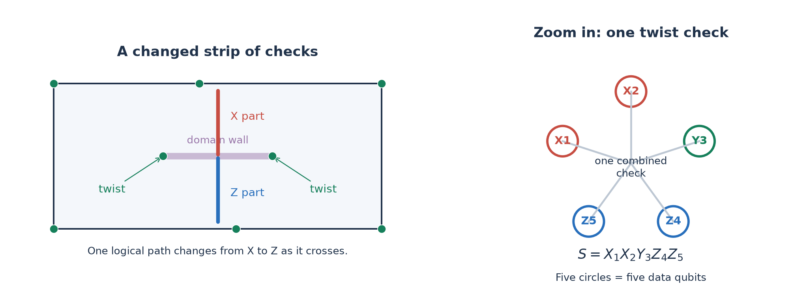
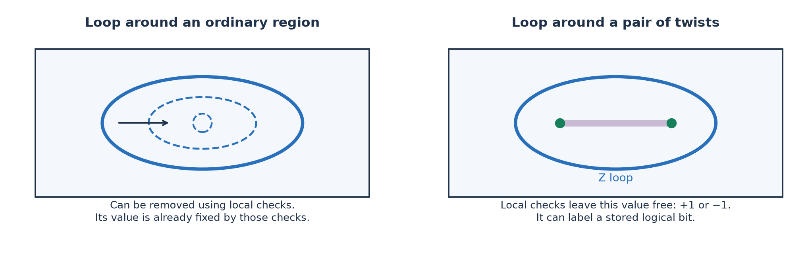
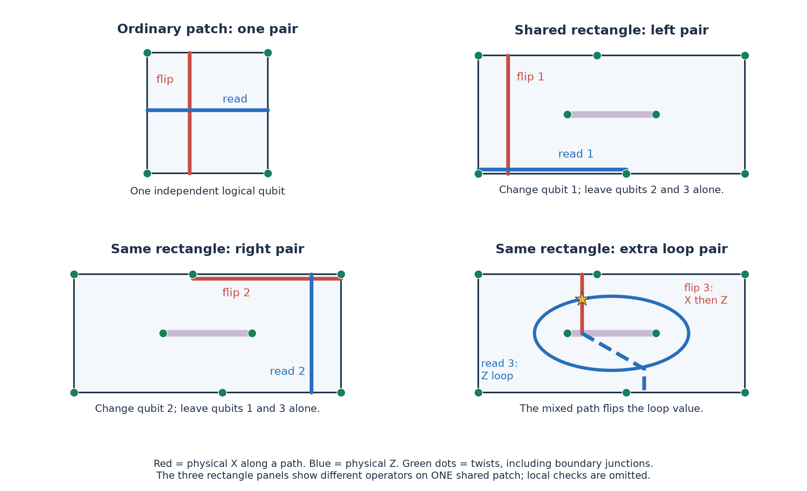
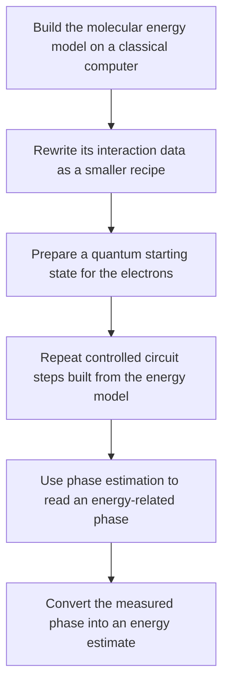

# A denser planar surface code: twist defects

Last updated: 2026-10-30

## Start with one ordinary surface-code patch

An ordinary rotated patch of distance $d$ has $d^2$ data qubits and $d^2-1$ independent checks. For a stabilizer code, the counting rule is

$$
\text{logical qubits}=\text{data qubits}-\text{independent checks}.
$$

So an ordinary patch stores $d^2-(d^2-1)=1$ logical qubit. Each independent check fixes one combined property of the data. The remaining freedom holds the logical quantum state. An *independent* check adds a new constraint; a check that can be obtained by multiplying other checks adds no new constraint.

For $d=5$, that is **25 data qubits, 24 independent checks, and one logical qubit**. The usual circuit also uses 24 measurement helpers, making 49 physical qubits altogether. This is the kind of patch in the [surface-code notebook](../../surface_code.ipynb). [Google paper, §II and Fig. 3](https://arxiv.org/pdf/2605.30455v1#page=5)

**To store more logical qubits in a shared patch, we must change its checks and boundaries so that more independent quantum information remains free.** The tool for doing this is a twist defect.

## What is a twist defect?

Ordinary surface-code checks come in two types: $X$ checks and $Z$ checks. Most interior checks act on four data qubits, measuring a combined property such as $XXXX$ or $ZZZZ$.

Now change the checks along a strip inside the patch. Across this strip, the roles of $X$ and $Z$ exchange. The strip is called a **domain wall**. A **twist defect is an endpoint of that wall**, where the usual pattern of checks has to change.

At an interior twist, one check can look like

$$
S=X_1X_2Y_3Z_4Z_5.
$$

The subscripts label five nearby data qubits. This is one combined check involving both $X$ and $Z$, with a $Y$ on one qubit. Here $Y$ is the third Pauli operation, combining $X$- and $Z$-type action. We change what the checking circuit measures; no physical qubit needs to be twisted or moved. [Google paper, §III and Fig. 10](https://arxiv.org/pdf/2605.30455v1#page=13)

**Figure 1.** Purple marks the changed strip of checks; its two interior endpoints are twists. On the right, each numbered circle is a data qubit participating in one twist check. The lines group the five factors into a combined measurement. They do not specify chip wiring.

The red-and-blue line on the left shows a **pattern of Pauli operations on data qubits**. To fit the changed checks, an $X$ pattern on one side continues as a $Z$ pattern on the other. The two coloured parts belong to one pattern. A qubit is not travelling along the line or changing into another kind of qubit.

That explains the word *twist*. The next question is why this changed pattern of checks creates room for more information.

## Why can a loop around twists hold information?

A stored logical qubit must have properties that the error checks **leave unknown**. Otherwise, repeatedly checking for errors would also read the stored quantum state.

In a surface code, some of these properties are represented by long **strings or loops of Pauli operations**. There are two different possibilities:

- A pattern made by multiplying local stabilizer checks has a value already fixed by those checks. It adds no stored information.
- A pattern that passes every check but is not a product of checks can act on the stored logical information. This is a **logical operator**.

An ordinary closed loop around a region with no defects can be reduced by multiplying local checks: the loop gets smaller until nothing remains. Its value is fixed. In Google's rectangle, a loop enclosing the two interior twists cannot be removed this way. **Its value can be $+1$ or $-1$ while all the local check values remain the same.** We can label $+1$ as logical zero and $-1$ as logical one. That leaves a place to store a logical bit. [Google paper, Fig. 10, middle; twist-encoding explanation in Brown et al., §III.F](https://arxiv.org/pdf/2605.30455v1#page=13), [Brown et al.](https://arxiv.org/html/1609.04673#S3.SS6)

**Figure 2.** The dashed loops on the left represent equivalent, smaller patterns obtained using local checks. On the right, the twist pair gives the loop a logical value that local checks do not fix. During storage we measure the local checks, leaving this logical value unmeasured.

The new loop is only half the story. To identify a whole logical qubit, we also need a second pattern that **flips the loop's value**. The domain wall makes a mixed $X/Z$ pattern possible, and that pattern supplies the other half.

## Find the three logical qubits on one shared patch

For each logical qubit, look for a pair of operations:

- **Read:** an operator whose two possible values label logical zero and logical one. This is called logical $Z$, written $\bar Z$.
- **Flip:** an operator that exchanges those values while leaving the error checks unchanged. This is logical $X$, written $\bar X$.

These are descriptions of the encoded operations. During storage, we do not actually read the logical qubits. The stored state can be a quantum superposition of zero and one.

An ordinary patch has one independent read–flip pair. Google's shared rectangle has **three**. The next figure separates them so they can be followed one at a time. [Google paper, Fig. 10, middle](https://arxiv.org/pdf/2605.30455v1#page=13)

**Figure 3.** The three rectangles show the **same patch**, with different logical operations highlighted. Paths show the connections of the logical operators; individual data qubits and local checks are omitted. The paths follow the logical structure in the paper's Fig. 10. Green dots include twists at the outer boundary, where its two boundary types meet.

Read the rectangle panels in this order:

1. **Left pair:** the blue path gives the first logical value. The red path can flip it without changing the other two logical values.
2. **Right pair:** another pair does the same job for a second logical qubit.
3. **Loop pair:** the blue loop around the interior twists gives the third logical value. The red-and-dashed-blue path can flip it. Its physical operations change from $X$ to $Z$ across the wall, but the whole pattern acts as one logical flip.

In the last panel, the mixed path crosses the loop twice. At the star, physical $X$ meets physical $Z$, which reverses the loop's sign. At the lower crossing, $Z$ meets $Z$, which does not reverse it. The net result is **one sign reversal**: the loop value flips. This is the picture behind the mathematical term *anticommutation*.

The three pairs act independently: flipping one logical value leaves the other two alone. Thus the patch can hold the eight logical basis states $000,001,\ldots,111$, and quantum superpositions of them. The three logical qubits share the data qubits; they do not need three disjoint physical squares.

### Check the logical-qubit count

The paper's small rectangle in Fig. 10 is a $[[49,3,5]]$ code: 49 data qubits, three logical qubits, and formal code distance five. Therefore its independent stabilizer count is $49-3=46$.

| Layout | Data qubits | Independent checks | Logical qubits |
| --- | ---: | ---: | ---: |
| One ordinary distance-five patch | 25 | 24 | $25-24=1$ |
| Two separate distance-five patches | 50 | 48 | $50-48=2$ |
| The shared rectangle in Fig. 10 | 49 | 46 | $49-46=3$ |

Measurement helpers are excluded from this table. The last row uses the paper's code parameters; the check count follows from the stabilizer counting rule. [Google paper, Fig. 10](https://arxiv.org/pdf/2605.30455v1#page=13)

**The change is in the constraints:** roughly two patches' worth of data now support three independent logical qubits. Twists and the changed boundaries let us keep local error checks while leaving the extra loop value free.

The new information must still be spread over a long pattern of data qubits. Simply dropping arbitrary checks can leave information that a small error easily damages. The team keeps twists far enough from each other and from boundaries to avoid those short error paths.

Simply renaming $X$ as $Z$ would leave the number of constraints unchanged. Google's rectangle changes the actual check layout and the boundary arrangement. It has two interior twists and six boundary junctions, including the four outer corners. Looking only at the two interior endpoints misses part of the construction. Boundary junctions can themselves be understood as twists. [Google paper, Figs. 10 and 13](https://arxiv.org/pdf/2605.30455v1#page=17), [boundary-twist explanation, Brown et al., §III.G](https://arxiv.org/html/1609.04673#S3.SS7)

## What did the Google team make practical?

Twist defects were known before this paper. The team's contribution is to **measure their checks efficiently and place them carefully enough to make dense storage useful**.

A five-qubit mixed check is harder to measure than an ordinary four-qubit check. The team breaks the measurement into smaller pieces, called **gauge measurements**, and combines the appropriate answers to recover the desired stabilizer value. The individual pieces can have random answers; their prescribed combined parity carries the check information.

Their schedule needs only nearby interactions on a regular hexagonal grid, with four layers of two-qubit gates per cycle, plus reset and measurement. They also choose gate order and twist spacing to limit dangerous error propagation. A single faulty gate can spread an error to several data qubits—a **hook error**—so a nice drawing of a code is not enough. They test the resulting memory circuits using noisy simulations and a decoder. [Google paper, §III and Tables III–IV](https://arxiv.org/pdf/2605.30455v1#page=14)

## How much denser is it?

The comparison counts **data qubits and measurement helpers**. An ordinary patch uses approximately $2d^2$ physical qubits; its exact usual memory count is $2d^2-1$.

| Arrangement | Where the saving comes from |
| --- | --- |
| **Three-qubit rectangle: $1.5\times$ density** | Three logical qubits occupy $4d^2$ physical-qubit sites, the footprint of two compact ordinary patches. This compares equal effective size $d$ and approximately similar simulated memory performance. |
| **Larger packing: about $2\times$ density** | Join many rectangles and share more boundaries. In a large array, the physical-qubit cost approaches $d(d-1)$ per logical qubit, versus approximately $2d^2$ for separate patches. Finite arrays pay extra boundary costs. |
| **Yoked dense memory: projected up to $4.5\times$** | Add checks between logical qubits so smaller inner patches can meet the target error rate. This is the total projected gain over ordinary memory, including dense packing. It assumes an ideal outer decoder and modeled access-operation errors. |

The first two rows describe the packing mechanism. The last row adds another layer of error protection, called **yoking**, with its own time and space costs. The three gains are not factors to multiply together. [Google paper, Fig. 11 and §III](https://arxiv.org/pdf/2605.30455v1#page=14)

Further details: reliability and using the memory

### What has been tested?

The paper simulates the compact ordinary patch, the three-qubit rectangle and a 27-logical-qubit dense memory with circuit-level noise. It uses Stim sampling and two-pass correlated minimum-weight perfect matching to decode the measurement history. The main noise model assigns error strength $10^{-3}$ to gates, idles, resets and measurements using the rules in Appendix A. These are simulated circuits, rather than a hardware demonstration. [§I.A.1 and Appendix A](https://arxiv.org/pdf/2605.30455v1#page=61)

**Code distance and measured reliability are different things.** Distance counts the smallest undetectable logical pattern. Reliability also depends on how likely different faults are, how gates spread them, and how the decoder handles them. The rectangle's size parameter $d$ is an effective-distance label based on its height. Its measured logical error rate roughly follows $3.5^{-d}/10$ per round per logical qubit, comparable to one ordinary-patch orientation. A better idling orientation follows $4^{-d}/10$. [Figs. 6 and 13](https://arxiv.org/pdf/2605.30455v1#page=17)

The short twist schedule still loses one unit of distance across the wall; an eight-layer alternative removes that loss. Some diagonal $YY$ hook-error chains have short formal paths but remain rare in the chosen noise model. That rarity helps the packing perform well. Biased noise, correlated faults, leakage or different idle errors could change the useful layout and schedule. These require new benchmarks under a realistic device model. [Table III and §III.A](https://arxiv.org/pdf/2605.30455v1#page=16)

The $4.5\times$ projection does **not** come from simulating a complete working yoked memory. Yoking adds outer parity checks across columns of logical qubits. The analysis assumes an ideal outer decoder that can locate detectable faults and combine information from neighboring columns. The full outer decoder and the twist-based operations used to measure those checks remain to be benchmarked. [§III.B and §VI.D](https://arxiv.org/pdf/2605.30455v1#page=56)

### How do we compute with the stored qubits?

A logical operator on an accessible boundary can join a lattice-surgery measurement directly. An operator inside dense memory first needs to be brought to a boundary, or its qubit **unloaded** into an ordinary patch. Loading reverses the transfer. These operations change boundaries through merges and splits while tracking measurement outcomes. Their full error performance has not been benchmarked. [§III.A.3, Fig. 17](https://arxiv.org/pdf/2605.30455v1#page=19)

This suggests two roles: **cold storage** holds many rarely used qubits densely; **hot storage and compute workspace** keep frequently used qubits accessible and provide room for gates and magic-state production. Slow access and delays to the outer checks cost time and can increase errors. Density is especially helpful when the algorithm can do much of its work between visits to cold storage. [§IV, Fig. 23](https://arxiv.org/pdf/2605.30455v1#page=24)

The paper separately makes ordinary lattice surgery fit into $2d^2$ sites per patch instead of the conventional $2(d+1)^2$. This is **padding-free surgery**: it removes conventional per-patch padding, while operations still need their ancillas and access space. At $d=5$, ordinary memory occupies 49 qubits, the conventional box has 72 sites, and the compact box has 50. [§II.B](https://arxiv.org/pdf/2605.30455v1#page=10)

## FeMoco algorithm: what is the computer calculating?

**FeMoco is the iron–molybdenum cofactor in nitrogenase**, an enzyme involved in turning nitrogen into ammonia. Understanding its electrons helps researchers study how that chemistry works. The calculation used here asks a specific question: **what is the lowest possible electronic energy of a chosen FeMoco model?** This is its *ground-state energy*. Comparing energies of different chemical structures can help investigate a reaction. [Reiher et al., FeMoco benchmark](https://arxiv.org/abs/1605.03590), [Google paper, §VI](https://arxiv.org/pdf/2605.30455v1#page=49)

### Represent the electrons with logical qubits

The benchmark selects **54 spatial orbitals** for detailed treatment. Each orbital has two spin choices, giving **108 spin-orbitals**. Think of a spin-orbital as an available electron slot. Its occupation is represented by one logical qubit:

- $0$: the slot is empty.
- $1$: the slot contains an electron.

The benchmark has 54 electrons distributed among these 108 slots. The quantum state can combine many occupation patterns, with correlations between them. These **108 logical qubits hold the electronic state**; additional logical qubits are needed to run the algorithm. Each logical qubit then needs many physical qubits for error protection. [Google paper, §VI and Table XII](https://arxiv.org/pdf/2605.30455v1#page=50)

### Extract energy using phase estimation

The **Hamiltonian**, usually written $H$, is the mathematical description of electron energies and interactions. It supplies the rules for the calculation.

1. **Make the recipe cheaper to execute.** The interaction data can be very large. The paper uses **DFTHC**, a way to approximate that data with a more compact mathematical recipe. This reduces the work needed to implement the model while keeping the required energy accuracy.
2. **Prepare a suitable starting state.** It must contain a ground-state component. Phase estimation can return energies present in the starting state, so a poor starting state can make the desired energy difficult to obtain.
3. **Apply the model repeatedly.** The recipe becomes a reusable circuit step called a **quantum walk**. Building it uses *block-encoding* and *qubitization*: methods for turning the energy model into a gate circuit with helper qubits. The algorithm applies controlled repetitions of this step.
4. **Read the phase and infer the energy.** For an encoded energy eigenstate, the walk produces a phase related to its energy. Think of phase as a clock-hand angle: different energies give different angles. Phase estimation uses helper qubits and interference to measure that phase. The known relationship converts it into an energy estimate. The paper also uses **spectrum amplification**, which changes the phase–energy relationship so low energies can be resolved with fewer walk steps. [Google paper, §VI, Eqs. (6.1)–(6.6)](https://arxiv.org/pdf/2605.30455v1#page=49)

The walk repeatedly looks up numerical coefficients and performs controlled rotations. A large part of the work therefore happens in the helper registers, while the electronic state needs only selected interactions. [Google paper, §VI.A and Fig. 45](https://arxiv.org/pdf/2605.30455v1#page=52)

### Why dense memory helps this algorithm

The electronic state must survive throughout the calculation, even while helper qubits are busy. **Dense cold storage holds much of that state; hot storage and compute space handle the frequent lookup, arithmetic and rotation work.** Selected stored qubits are brought into use when needed. The paper analyzes how to schedule these accesses and use buffers to reduce waiting. Its fastest layouts still need fuller scheduling validation. [Google paper, §VI.C](https://arxiv.org/pdf/2605.30455v1#page=55)

For the 108-spin-orbital benchmark, the compact estimate uses about **89,000 physical qubits and less than one month**. It assumes physical error strength $10^{-3}$, a $1\,\mu\mathrm{s}$ code cycle and $10\,\mu\mathrm{s}$ classical reaction time. The phase-estimation uncertainty target is 1 millihartree, within a chemical-accuracy budget of about 1.6 millihartree. The estimates **assume perfect ground-state overlap and omit starting-state preparation cost**; the authors expect that cost to be smaller than the main calculation. These are resource estimates, rather than a completed FeMoco computation. [Google paper, Fig. 1 and §VI](https://arxiv.org/pdf/2605.30455v1#page=49)

The reported **$36\times$ reduction in physical qubits** combines denser codes, the storage/workspace layout, gate compilation and algorithm improvements. It compares the compact estimate with an earlier estimate of about 3.2 million physical qubits. It is not a $36\times$ density gain from twists alone. The smaller machine also runs longer than the earlier roughly three-hour configuration. [Google paper, Figs. 1 and 44](https://arxiv.org/pdf/2605.30455v1#page=51)
