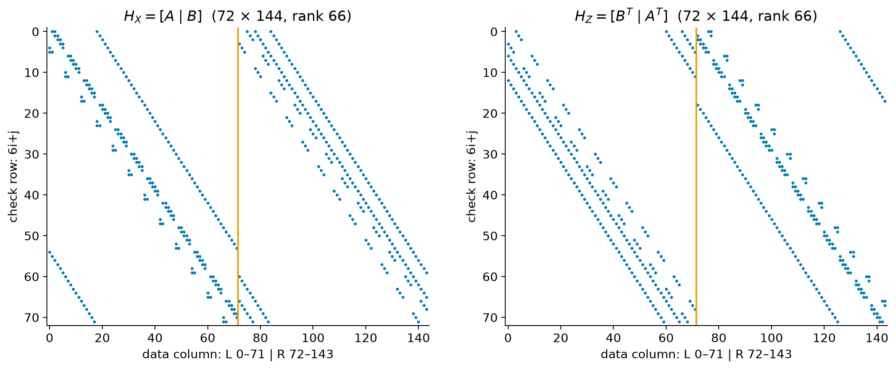

# Gross code: from connections to protected logical operations

Status: Draft
Last updated: 2026-10-13

## Overview

The Gross code is a quantum error-correcting code with parameters $[[144,12,12]]$: it stores twelve logical qubits in 144 data qubits, with code distance twelve. The original repeated-check implementation adds 144 measurement ancillas, making 288 physical qubits for the memory. A gross is twelve dozen, hence the name. IBM researchers introduced this bivariate bicycle (BB) code in a 2023 preprint, published in *Nature* in 2024. [Bravyi et al.](https://www.nature.com/articles/s41586-024-07107-7)

Our aim is to understand how a list of physical connections becomes a protected quantum memory, and then how to operate on its information. Read in order: connection recipes → checks → commutation → independent constraints → logical operators → distance → gates → readout → hardware.

The accompanying figures are generated from the same explicit check matrices used for the calculations. [The example script](build_examples.py) exports both matrices and all twelve logical pairs. Published distance results and proposed hardware protocols are distinguished from the calculations executed here.

## Basic intuitions

### What an error check actually measures

An $X$ check on six data qubits measures an operator such as $X_1X_2X_3X_4X_5X_6$. Its answer is one sign, $+1$ or $-1$. It does not return six separate qubit values. The code space consists of states for which every stabilizer check has eigenvalue $+1$; a changed sign is an error syndrome.

An $X$ error flips the signs of overlapping $Z$ checks; a $Z$ error flips overlapping $X$ checks. Each Gross-code data qubit belongs to three checks of each type. A single $X$ or $Z$ error therefore flips three appropriate checks; a $Y$ error flips both sets. We will reproduce one such error explicitly below.

### Reading the supplied picture

The supplied figure is a **Tanner graph**: circles are data qubits and squares are check ancillas. Blue circles are $L$ data, orange circles are $R$ data, pink squares measure $X$ checks, and green squares measure $Z$ checks. An edge says that this check acts on this data qubit. In the original implementation it is also a required ancilla–data interaction.

There are four kinds of vertices, each with 72 members. Every vertex has six incident edges. Many long edges are omitted from the published drawing to keep it readable. Dotted versus solid edges label the $A$ and $B$ families; they do not label $X$ versus $Z$ checks.

Opposite boundaries are identified: left with right and bottom with top. This periodic graph can be drawn on a torus. That does not make it an ordinary toric code: the extra edges change the parity constraints, so the number of logical qubits is not determined by counting two geometric holes.

### A and B are reusable recipes, not gates

Give each kind of vertex an address $(i,j)$, with

$$
i\in\{0,\ldots,11\},\qquad j\in\{0,\ldots,5\}.
$$

Coordinates wrap: $(12,j)=(0,j)$ and $(i,6)=(i,0)$. There are two data qubits per address, $L(i,j)$ and $R(i,j)$, hence $2\times12\times6=144$ data qubits.

Let $x$ mean “increase $i$ by one” and $y$ mean “increase $j$ by one.” The recipes are

$$
A=x^3+y+y^2,\qquad B=y^3+x+x^2.
$$

Here $x^3$ means a three-step shift, not three qubits or three gates. The plus signs list positions to include. In their binary algebra, repeated terms cancel, since applying the same Pauli twice gives identity.

An $X$ check at address $(i,j)$ acts on the three $L$ qubits in recipe $A$ and three $R$ qubits in recipe $B$:

$$
S_X(i,j)=X_{L(i+3,j)}X_{L(i,j+1)}X_{L(i,j+2)}
X_{R(i,j+3)}X_{R(i+1,j)}X_{R(i+2,j)}.
$$

All coordinates in this page are reduced modulo $(12,6)$. For example, the check $S_X(4,2)$ uses exactly these six data qubits:

| Recipe | Term | Data qubit |
| --- | --- | --- |
| $A$ | $x^3$ | $L(7,2)$ |
| $A$ | $y$ | $L(4,3)$ |
| $A$ | $y^2$ | $L(4,4)$ |
| $B$ | $y^3$ | $R(4,5)$ |
| $B$ | $x$ | $R(5,2)$ |
| $B$ | $x^2$ | $R(6,2)$ |


The figure uses an interleaved toric drawing so that four of these neighbors are one drawn edge away. The two cubic terms give the extra connections. **Algebraic addresses are not the drawn Cartesian positions.** One explicit embedding, which the script uses, is

$$
\begin{aligned}
X(i,j)&\mapsto(2i,2j),&L(i,j)&\mapsto(2i,2j-3),\\
R(i,j)&\mapsto(2i-3,2j),&Z(i,j)&\mapsto(2i-3,2j-3),
\end{aligned}
$$

with drawn coordinates taken modulo $(24,12)$. Substituting the six addresses into this map explains the four short edges and two longer edges in the plot. This is a labeling of the graph, not a proposed chip floorplan.

Wrapping is just modular arithmetic in the recipe. For $S_X(11,5)$ the six positions become $L(2,5)$, $L(11,0)$, $L(11,1)$, $R(11,2)$, $R(0,5)$, and $R(1,5)$.

To make a $Z$ check, exchange the recipes between the registers and reverse the shifts:

$$
S_Z(i,j)=Z_{L(i,j-3)}Z_{L(i-1,j)}Z_{L(i-2,j)}
Z_{R(i-3,j)}Z_{R(i,j-1)}Z_{R(i,j-2)}.
$$

These rules fully specify the code. The choice of shifts is important: six arbitrary neighbors would not automatically give commuting checks, twelve logical qubits, or distance twelve. [Construction in Cross et al., Section 4](https://arxiv.org/html/2407.18393v2#S4)

## Formal descriptions

### 1. Turning the recipes into binary matrices

A binary check row records **where a Pauli acts**: put a 1 in a qubit's column if the check includes it, otherwise 0. Fix the column order

$$
\operatorname{col}(L(i,j))=6i+j,\qquad
\operatorname{col}(R(i,j))=72+6i+j.
$$

There is one row per check address, numbered $6i+j$. Thus both $H_X$ and $H_Z$ have 72 rows and 144 columns. The row for $S_X(0,0)$ has ones at

$$
\underbrace{1,2,18}_{L\text{ columns}},\qquad
\underbrace{75,78,84}_{R\text{ columns}}.
$$

Those columns mean $L(0,1),L(0,2),L(3,0),R(0,3),R(1,0),R(2,0)$.

A direct construction is:

```python
import numpy as np

ell, m = 12, 6
A_terms = [(3, 0), (0, 1), (0, 2)]
B_terms = [(0, 3), (1, 0), (2, 0)]

def checks(left_terms, right_terms):
    H = np.zeros((ell*m, 2*ell*m), dtype=np.uint8)
    for i in range(ell):
        for j in range(m):
            for offset, terms in [(0, left_terms), (ell*m, right_terms)]:
                for di, dj in terms:
                    q = offset + ((i+di) % ell)*m + (j+dj) % m
                    H[i*m+j, q] ^= 1
    return H

HX = checks(A_terms, B_terms)
HZ = checks([(-di, -dj) for di, dj in B_terms],
            [(-di, -dj) for di, dj in A_terms])
assert not np.any((HX @ HZ.T) % 2)
```



The exports [H_X.csv](H_X.csv) and [H_Z.csv](H_Z.csv) contain every entry. The left and right blocks describe the $L$ and $R$ registers.

There is another useful interpretation of $A$ and $B$. Let $x$ and $y$ now denote 72-by-72 permutation matrices whose row $(i,j)$ selects column $(i+1,j)$ or $(i,j+1)$. Then

$$
A=x^3+y+y^2,\quad B=y^3+x+x^2,\quad
H_X=[A\mid B],\quad H_Z=[B^T\mid A^T].
$$

Polynomial and matrix notation describe the same construction. The transpose reverses shifts. We have explicitly chosen a row convention; switching a shift-matrix convention requires switching the coordinate labels consistently.

### 2. Why every X check commutes with every Z check

On one shared qubit, $XZ=-ZX$. On $r$ shared qubits, exchanging the two checks produces $(-1)^r$. They commute exactly when their overlap is even.

Take $S_X(0,0)$ and $S_Z(3,3)$. Their supports are

| Check | $L$ support | $R$ support |
| --- | --- | --- |
| $S_X(0,0)$ | $(3,0),(0,1),(0,2)$ | $(0,3),(1,0),(2,0)$ |
| $S_Z(3,3)$ | $(3,0),(2,3),(1,3)$ | $(0,3),(3,2),(3,1)$ |

They share $L(3,0)$ and $R(0,3)$: two minus signs cancel.


For **all** check pairs at once, matrix multiplication counts overlaps modulo two:

$$
H_XH_Z^T=[A\mid B]\begin{bmatrix}B\\A\end{bmatrix}=AB+BA.
$$

Horizontal and vertical shifts commute, including at the periodic boundaries. Therefore polynomials in these shifts commute, $AB=BA$. Over binary arithmetic,

$$
AB+BA=AB+AB=0.
$$

This is why the reversed, exchanged $Z$ recipe works. The example script additionally checks all $72\times72=5184$ overlaps: the commutation matrix has zero nonzero entries. Same-type checks already commute because they use only $X$ or only $Z$.

### 3. Why the code has twelve logical qubits

Each independent commuting stabilizer halves the allowed Hilbert-space dimension. Starting from $2^{144}$ dimensions, $r$ independent checks leave $2^{144-r}$ dimensions, equivalent to $144-r$ qubits.

For this CSS code, pure-$X$ and pure-$Z$ generators are independent of one another as Pauli constraints, so

$$
k=n-\operatorname{rank}_{\mathbb F_2}(H_X)
-\operatorname{rank}_{\mathbb F_2}(H_Z).
$$

The executed binary Gaussian elimination gives

$$
\operatorname{rank}_{\mathbb F_2}(H_X)=66,\qquad
\operatorname{rank}_{\mathbb F_2}(H_Z)=66,
\qquad k=144-132=12.
$$

There are 72 measured checks of each type, but six redundant relations in each set. For an elementary example of redundancy, $Z_1Z_2$ and $Z_2Z_3$ multiply to $Z_1Z_3$; measuring the latter adds no independent constraint. Gross-code dependencies involve larger collections of checks, but the principle is identical.

Binary Gaussian elimination uses row swaps and row XORs. XOR corresponds to multiplying check operators; it preserves their generated stabilizer group. A zero row means an existing combination multiplies to identity. Do not use an ordinary floating-point matrix rank: the relevant arithmetic is modulo two.

**Is this the best way to count logical qubits?** For an explicitly given finite stabilizer code, it is a standard, efficient, exact method. We do not need to construct any $2^{144}$-dimensional quantum state. BB algebra also gives $k=2\dim(\ker A\cap\ker B)$, which is useful for understanding families. The binary rank calculation remains the most direct reproducible count for this particular instance. [General stabilizer formalism, Gottesman, Chapter 3](https://arxiv.org/html/quant-ph/9705052#S3)

### 4. Finding logical operators rather than guessing strings

Represent a pure-$Z$ pattern by a binary vector $z$: its ones specify which data qubits receive $Z$. It is invisible to the checks when

$$
H_Xz=0.
$$

But some invisible patterns are stabilizers. Their vectors are row combinations of $H_Z$. The meaningful logical patterns are therefore

$$
\text{logical }Z\text{ classes}=\ker H_X/\operatorname{rowspace}(H_Z).
$$

The slash means “regard two patterns as equivalent when they differ by a stabilizer.” Likewise,

$$
\text{logical }X\text{ classes}=\ker H_Z/\operatorname{rowspace}(H_X).
$$

For example, a row of $H_Z$ is a weight-six, zero-syndrome $Z$ pattern. It is harmless on valid states; it is not a weight-six logical error. This distinction is essential when computing distance.

Here is a constructive procedure:

1. Use binary elimination to find a basis of $\ker H_X$. Its dimension is $144-66=78$.
2. Begin with the 66-dimensional row span of $H_Z$.
3. Process the kernel vectors. Keep one when it increases the current span, and add it to that span.
4. Exactly twelve additions remain. They give independent logical $Z$ classes.
5. Repeat with $X$ and $Z$ exchanged to get twelve logical $X$ classes.
6. Pair the classes so that $x_a\cdot z_b=\delta_{ab}$, using binary changes of basis.

Thus each logical $X_a$ anticommutes with its own $Z_a$ and commutes with the other eleven $Z_b$. This identifies twelve independently addressable *logical degrees of freedom*, not twelve disjoint physical regions.

The script performs these operations and exports all pairs in [verification.json](verification.json). It seeds the first pair with the following published representatives to make the diagrams easy to compare with the literature; it then constructs the other eleven by elimination. Gaussian elimination finds a basis, **not necessarily the smallest-weight representatives**.

Our first logical $Z$ has support

| Register | Coordinates |
| --- | --- |
| $L$ | $(2,3),(2,5),(3,0),(3,3),(3,4),(3,5)$ |
| $R$ | $(1,3),(1,5),(2,0),(2,4),(3,2),(3,4)$ |

Its paired logical $X$ has support

| Register | Coordinates |
| --- | --- |
| $L$ | $(0,1),(1,5),(2,2),(2,4),(3,1),(3,2),(4,1),(4,2),(9,3),(10,0),(11,0),(11,3)$ |
| $R$ | $(0,2),(1,1),(1,5),(6,0)$ |


They have weights 16 and 12. Both have zero syndrome, and their only shared site is $R(1,5)$, so they anticommute. This also proves neither is a stabilizer: every stabilizer must commute with every zero-syndrome Pauli. These supports are from equations (64)–(67) in [Cross et al.](https://arxiv.org/html/2407.18393v2#S4.SS1); the label “logical 1” is our local basis choice.

Multiplying either representative by a same-type stabilizer toggles six sites and produces another representative of the same logical operator. Logical operators consequently have many shapes. Weight 16 for this $X$ representative is compatible with code distance 12.

### 5. Why distance is twelve, and why that means five correctable errors

The mathematical distance is the minimum weight of a zero-syndrome Pauli with nontrivial logical action. For pure $Z$,

$$
d_Z=\min\{|z|:H_Xz=0,\ z\notin\operatorname{rowspace}(H_Z)\}.
$$

There is an analogous $d_X$, and for a CSS code $d=\min(d_X,d_Z)$. A mixed $X/Z$ logical cannot undercut both minima: at least one of its components is a nontrivial pure logical, and its full support is at least as large as that component's support.

The plotted logical $Z$ establishes $d\leq12$. **It does not establish $d\geq12$.** That needs a calculation excluding all smaller nontrivial logicals.

The original paper supplies the missing evidence: its [arXiv version, Table 3](https://arxiv.org/html/2308.07915#S4) reports the Gross instance with distance 12 and explains that distances were computed with mixed-integer programming. [Section 6](https://arxiv.org/html/2308.07915#S6) distinguishes heuristic BP-OSD screening from the final integer-programming calculation. The five-error guarantee is a consequence of the general distance theorem, rather than a separate Gross-code experiment.

Here is how an exact distance calculation can be posed using the logical basis we constructed. Solve, for each $a=1,\ldots,12$,

$$
D_a=\min_{z\in\{0,1\}^{144}}\sum_q z_q
\quad\text{subject to}\quad H_Xz=0,\quad x_a\cdot z=1
\quad(\bmod\ 2).
$$

The odd overlap guarantees the candidate is nontrivial. Every nontrivial logical $Z$ anticommutes with at least one member of a complete logical $X$ basis, so $d_Z=\min_aD_a$. Binary parity equations can be expressed as integer constraints:

$$
\sum_q(H_X)_{sq}z_q=2u_s,\qquad
\sum_q(x_a)_qz_q=1+2v,
$$

with integer auxiliary variables $u_s,v$. Repeat for $X$ logicals, or use the BB symmetry exchanging registers and reversing coordinates to establish $d_X=d_Z$. An exact solver must close the lower bound, not just return a weight-12 candidate. **We have not rerun this full lower-bound computation locally.** We rely on the paper for $d=12$ and independently verify the weight-12 witness.

To derive the correction guarantee, suppose two possible data errors $E$ and $F$ each affect at most $t$ qubits. Their relative error $E^\dagger F$ affects at most $2t$ qubits. If the two syndromes agree, this relative error commutes with all checks.

When $2t<d$, it cannot be a nontrivial logical. It is therefore a stabilizer, so correcting either explanation has the same action on encoded information. For $d=12$,

$$
t=\left\lfloor\frac{d-1}{2}\right\rfloor=5,\qquad 2\times5=10<12.
$$

Why not six? Divide the twelve sites of our logical $Z$ into two sets of six. Let $E$ apply $Z$ on the first set and $F$ on the second. Then $E^\dagger F=\bar Z_1$, so $E$ and $F$ have the same syndrome but differ logically. No decoder can always distinguish them.

This is an ideal-recovery guarantee for arbitrary errors on up to five data qubits, including coherent errors through their Pauli expansion. It assumes reliable syndrome information and a recovery that implements the required distinctions. It is not a promise that a practical approximate decoder always succeeds, nor that five faulty circuit locations are always correctable. [Quantum error-correction conditions, Gottesman, Chapters 2–3](https://arxiv.org/html/quant-ph/9705052)

### 6. What “144 physical CNOTs give twelve logical CNOTs” means

First separate **how many different gates you can request** from **how many gates one circuit implements**.

Within twelve logical qubits there are $12\times11=132$ directed control–target choices. Equivalently, choose one of $\binom{12}{2}=66$ unordered pairs, then choose either direction: $66\times2=132$. Multiplying $12\times11$ by another two counts both directions twice.

The 144-CNOT circuit concerns **two separate, identically encoded Gross blocks**, called $C$ and $T$. Apply one physical CNOT from data qubit $q$ in $C$ to the matching data qubit $q$ in $T$, for every $q=0,\ldots,143$:

$$
U=\prod_{q=0}^{143}\operatorname{CNOT}(q_C\rightarrow q_T).
$$

This is a transversal operation: each data qubit interacts with only its matching partner in the other block. The ideal gate itself uses 144 two-qubit gates, excluding preparation and error-correction circuitry. Parallel depth one would additionally require all matching couplings and simultaneous gates to be available.

The physical CNOT conjugation rules are

$$
\begin{aligned}
X_C&\mapsto X_CX_T,&X_T&\mapsto X_T,\\
Z_C&\mapsto Z_C,&Z_T&\mapsto Z_CZ_T.
\end{aligned}
$$

Apply them to a product of Paulis on the support of any logical representative. Because both blocks use the same physical support and logical basis,

$$
\begin{aligned}
\bar X_{a,C}&\mapsto\bar X_{a,C}\bar X_{a,T},&
\bar X_{a,T}&\mapsto\bar X_{a,T},\\
\bar Z_{a,C}&\mapsto\bar Z_{a,C},&
\bar Z_{a,T}&\mapsto\bar Z_{a,C}\bar Z_{a,T}.
\end{aligned}
$$

These are exactly the logical CNOT rules, simultaneously for $a=1,\ldots,12$. Stabilizers transform into stabilizers or products of corresponding stabilizers, so the code spaces are preserved. The implemented gate is

$$
\prod_{a=1}^{12}\overline{\operatorname{CNOT}}(a_C\rightarrow a_T),
$$

not all possible control–target combinations. The number 144 here comes from **144 matching physical data pairs**; its equality to $12^2$ is not a count of logical gate choices. Transversal CNOT is a CSS-code property; it is not the sparse inter-module gate mechanism assumed in IBM's bicycle architecture. [CSS fault-tolerant gates, Gottesman, Section 5.3](https://arxiv.org/html/quant-ph/9705052#S5.SS3)

### 7. A CNOT on two selected logical qubits

Suppose we want only $\overline{\operatorname{CNOT}}(c\rightarrow t)$. A useful exact logical circuit uses a third logical qubit $a$, prepared in $|+\rangle_L$. Measure these observables in this order:

| Step | Observable | Outcome bit |
| --- | --- | --- |
| 1 | $\bar Z_c\bar Z_a$ | $u$ |
| 2 | $\bar X_a\bar X_t$ | $v$ |
| 3 | $\bar Z_a$ | $w$ |

An eigenvalue $+1$ is encoded as bit 0, and $-1$ as bit 1. Finish with

$$
\bar Z_c^{\,v}\bar X_t^{\,u\oplus w}.
$$

Those corrections can be tracked in a Pauli frame. For example, outcomes $(u,v,w)=(1,0,0)$ require a target $X$ correction. The third logical qubit is consumed and can be reinitialized.


This is an exact unitary CNOT on $c,t$ after corrections, even for unknown superpositions and entangled inputs. The script verifies each branch as a **linear map on the whole four-dimensional input space**, not just on a few basis states: after correction, every branch is CNOT times a scalar of magnitude $1/\sqrt8$.

For a completely explicit physical example, select logical 1 as control and logical 2 as target **within the same 144-data-qubit block**, using our exported basis. Add an unencoded ancilla $a$ (physical qubit 144) and a measurement ancilla $b$ (physical qubit 145). The relevant data columns are

$$
\begin{aligned}
\operatorname{supp}(\bar Z_1)&=\{15,17,18,21,22,23,81,83,84,88,92,94\},\\
\operatorname{supp}(\bar X_2)&=\{3,6,12,15,18,24,39,42,48,51,54,60\}.
\end{aligned}
$$

The ideal physical recipe is:

1. Prepare $a$ in $|+\rangle$ and $b$ in $|0\rangle$.
2. Apply CNOT from each of the twelve $\bar Z_1$ data sites to $b$, and from $a$ to $b$. Measure $b$ in $Z$, obtaining $u$.
3. Reset $b$ to $|+\rangle$. Apply CNOT from $b$ to each of the twelve $\bar X_2$ data sites, and from $b$ to $a$. Measure $b$ in $X$, obtaining $v$.
4. Measure $a$ in $Z$, obtaining $w$.
5. Apply or track $Z$ on the twelve $\bar Z_1$ sites if $v=1$, and $X$ on the twelve $\bar X_2$ sites if $u\oplus w=1$.

This circuit uses 26 quantum CNOTs, two additional physical qubits, and three measurements, assuming the necessary couplings. It implements just the requested logical CNOT, leaving the ten other logical qubits unchanged. The [complete Stim gate list](selected_cnot_ideal.stim) contains these operations and the classical corrections. On the full physical code, we verified all four computational-basis truth-table cases and an encoded Bell-pair example, including preservation of all original stabilizers and the prepared spectator logical states.

**This ideal physical demonstration is not fault tolerant.** Its unencoded ancilla and sequential high-weight parity measurements allow individual faults to become logical failures. The point of spelling it out is to connect the logical boxes to actual physical gates. A protected implementation replaces those parity measurements with the auxiliary code-deformation systems described next; the 26-gate figure is not their resource count.

So far this specifies the logical circuit. To realize it in Gross-code hardware, each box must become a protected logical-parity measurement. The qubits in a box share physical support with other logical qubits; measuring all their constituent data qubits separately would reveal too much information.

### 8. How a physical auxiliary system measures a logical parity

The following explicit construction explains the cancellation mechanism. It is an **algebraic teaching example, not a distance-preserving hardware design**.

List the twelve data sites of $\bar Z_1$ as $q_1,\ldots,q_{12}$. Put an auxiliary edge qubit $e_r$ between each consecutive pair. Define new checks

$$
Q_1=Z_{q_1}X_{e_1},\quad
Q_r=Z_{q_r}X_{e_{r-1}}X_{e_r}\ (2\leq r\leq11),\quad
Q_{12}=Z_{q_{12}}X_{e_{11}}.
$$

Every edge Pauli appears twice when all checks are multiplied, so

$$
\prod_{r=1}^{12}Q_r=\prod_{r=1}^{12}Z_{q_r}=\bar Z_1.
$$


For the actual coordinate list above, $q_1=L(2,3)$ and $q_2=L(2,5)$, so the first two checks are $Z_{L(2,3)}X_{e_1}$ and $Z_{L(2,5)}X_{e_1}X_{e_2}$. Their local results are not individual data-qubit values: each also involves an initially unknown $X$ parity of auxiliary qubits prepared in $|0\rangle$. The product of all vertex-check results gives only the intended logical parity.

There is one more essential step: **the old checks must change too**. An original $X$ check $X(h)$ need not commute with a single new $Q_r$. Let $h_r=1$ when it includes $q_r$, and define

$$
b_r=h_1\oplus\cdots\oplus h_r,\qquad
\widetilde S_X(h)=X(h)\prod_{r=1}^{11}Z_{e_r}^{b_r}.
$$

Because the original check commutes with $\bar Z_1$, the sum of all twelve $h_r$ is even. At vertex $r$, the data overlap contributes sign $(-1)^{h_r}$ and the auxiliary overlap contributes $(-1)^{b_{r-1}+b_r}$; these cancel. The script checks this for all 72 original $X$ checks. Original $Z$ checks already commute with the new checks.

This temporary change is **code deformation**. The logical observable becomes a product of checks in the enlarged code. Closing the deformation requires measuring auxiliary qubits in $Z$, returning to the original checks, and accounting for the corresponding Pauli-frame changes. Measuring the $Q_r$ once is not by itself a complete fault-tolerant protocol.

Published Gross-code proposals replace the illustrative path with carefully chosen auxiliary graphs, additional checks, and repeated syndrome rounds. The aim is to preserve protection while making the logical-parity result trustworthy. They use both these measurements and physical permutations that preserve the code, called automorphisms. A physical permutation can act as a logical CNOT network because logical qubits are collective degrees of freedom.

The compact schemes use designated logical access points; arbitrary requested CNOTs are **compiled** into the available measurements and automorphisms, not performed by selecting a single physical edge. In the cited scheme, one of twelve logical qubits is reserved for synthesis, leaving eleven computational data qubits. Thus it is necessary to distinguish twelve-qubit storage from the logical instruction set of a particular computing architecture. [Cross et al., Gross-code gate construction](https://arxiv.org/html/2407.18393v2#S4); [Yoder et al., Sections 1.2, 2.3 and Appendix A.4](https://arxiv.org/html/2506.03094v1)

At the physical-gate level, a pure $Z$ check is measured by preparing a measurement ancilla in $|0\rangle$, applying data-to-ancilla CNOTs, and measuring it in $Z$. A pure $X$ check uses a $|+\rangle$ ancilla, ancilla-to-data CNOTs, and an $X$ measurement. Mixed-Pauli checks require the appropriate basis changes or equivalent gate circuits. In a full protocol these gates must be scheduled with the other checks to control error propagation.

The exact logical gadget above and the auxiliary-product identity have been checked here. A complete low-level schedule compiling a named arbitrary CNOT into the published fixed-connectivity Gross LPU has **not** been generated. The distinction matters: the logical gadget explains exactly what operation is needed, while that compilation determines the actual hardware gate count and time.

### 9. Reading out encoded information

For final $Z$-basis readout of all twelve logical qubits, measure every data qubit in $Z$. Write its outcome as bit $m_q$, with sign $(-1)^{m_q}$. Then

$$
\ell_a^{\rm raw}=z_a\cdot m\pmod2.
$$

The logical eigenvalue is $(-1)^{\ell_a}$. The individual data outcomes are generally random; their selected parities carry the logical results.

The final outcomes also supply the compatible $Z$-check parities,

$$
s_Z=H_Zm\pmod2.
$$

In practice the decoder combines these with preceding repeated-check results and the tracked Pauli frame. If it infers an $X$-component error $\hat e_X$ that flips data-readout bits, the corrected logical result is

$$
\ell_a=z_a\cdot(m\oplus\hat e_X)
=\ell_a^{\rm raw}\oplus z_a\cdot\hat e_X.
$$

No physical correction gates are needed after the destructive measurement. For whole-block $X$ readout, exchange $X$ and $Z$: use the $x_a$ supports, compatible $X$-check parities, and inferred $Z$ errors.

Selective readout while retaining the other logical qubits uses the collective auxiliary measurement procedure instead. Knowing a support does not authorize measuring every qubit on it individually. A logical measurement returns an eigenvalue of a chosen observable, not a classical description of an arbitrary quantum state or simultaneous values of incompatible $X$ and $Z$ observables.

## Worked examples

### A complete single-error readout example

Consider $|0\rangle_L^{\otimes12}$. Its noiseless computational-basis outcomes lie in the row span of $H_X$ for our chosen logical basis. To see why, a constructive expression is

$$
|0\rangle_L^{\otimes12}=\frac1{\sqrt{2^{66}}}
\sum_{s\in\operatorname{rowspace}(H_X)}|s\rangle.
$$

Every $X$ stabilizer permutes this sum; every $Z$ stabilizer and logical $Z_a$ has even overlap with each $s$. Thus all checks and all logical $Z_a$ have sign $+1$. There are many random physical readout strings but the twelve logical parities are all zero.

The script chooses one allowed noiseless string by XORing check rows 0, 5, 12, and 38. Then it injects $X$ on $R(1,5)$, data column 83. The three fired $Z$ checks are

$$
S_Z(1,0),\qquad S_Z(1,1),\qquad S_Z(4,5).
$$

Check these directly using the reversed-$A$ recipe: those are precisely the checks whose $R$ support contains $(1,5)$.

Because that site lies on $\bar Z_1$, its raw logical bit changes from 0 to 1. Searching the 144 single-$X$-error columns of $H_Z$ finds exactly one matching syndrome, column 83. The inferred correction flips that bit back:

$$
\ell_1^{\rm corrected}=1\oplus1=0.
$$

This is a noiseless-syndrome example with one data error. With measurement faults and ongoing circuit noise, a three-bit syndrome lookup is insufficient; a history-based decoder is needed.

### Reproducing the calculations and figures

From the repository root, run

```bash
.venv/bin/python qec_knowledge_base/gross-code/build_examples.py
```

The script requires the repository's existing NumPy, Matplotlib, and Stim dependencies. It produces PNG and SVG figures, two binary-matrix CSV files, an ideal selected-CNOT Stim circuit, and [verification.json](verification.json). The executed results are:

| Calculation | Result |
| --- | --- |
| Data qubits | 144 |
| Check matrices | Two 72-by-144 matrices |
| Row weight of each matrix | 6 |
| Column weight of each matrix | 3 |
| Binary ranks | 66 and 66 |
| Kernel dimensions | 78 and 78 |
| Encoded logical qubits | 12 |
| Nonzero entries of $H_XH_Z^T$ modulo two | 0 |
| Logical pairs exported | 12 |
| Logical overlap matrix $x_a\cdot z_b$ | 12-by-12 identity |
| First logical pair weights | 16 and 12 |
| CNOT measurement branches verified | All 8, as complete linear maps |
| Selected physical CNOT within one Gross block | Four truth-table cases and an encoded Bell pair verified |
| Auxiliary-path product and dressed-check commutation | Verified |
| Single-error readout | Raw logical bit 1, corrected logical bit 0 |

Only the first pair is chosen to match the plotted published supports. The remaining basis representatives have various weights; their weights are not claimed to be minimal.

## Limitations

### Why the long and wraparound connections are physically difficult

Periodic indexing makes opposite addresses adjacent **mathematically**. It does not make the opposite edges of a flat chip adjacent. A wraparound interaction needs a routed coupler, another packaging layer, a layout change, or an indirect gate protocol. The same problem occurs for the extra bulk edges. Shortening some routes by rearranging qubits may lengthen others; their connectivity graph cannot be realized entirely as local planar nearest-neighbor couplings.

The obstacles are concrete:

| Obstacle | Physical mechanism | Consequence |
| --- | --- | --- |
| Crossings and crowded routes | Independent microwave paths cannot simply intersect as connected metal wires | Need bridges, shielding, vias, or extra routing tiers |
| Added loss | Couplers and interfaces introduce electromagnetic participation in imperfect materials | Can reduce coherence or gate quality |
| Unwanted coupling | A coupler can retain residual interactions; control pulses can affect spectators | Phase errors and correlated errors during parallel gates |
| Extra modes and frequency constraints | Extended microwave structures have modes that must be engineered alongside qubit frequencies | Harder calibration and collision avoidance |
| Greater connectivity | A qubit must accommodate multiple couplers plus control and readout structures | Increased layout and isolation demands |
| Indirect interactions | SWAP routing or teleportation adds gates, ancillas, measurements, or latency | More error opportunities and longer cycles |

These are engineering mechanisms, not a theorem that a distant gate must be bad. Dedicated long-range couplers can work well; the challenge is obtaining sufficiently good performance across the full repeatedly operated device. The routing study by Mathews et al. explicitly treats crossings, shielding, vias and bump bonds; one Gross-code layout in its model uses the qubit tier plus four higher tiers. This is an example under its layout constraints, not a universal five-tier requirement. [Mathews et al., Sections II–III](https://arxiv.org/html/2507.23011)

For a simple routing estimate, let the desired control and target be $r$ nearest-neighbor edges apart. Moving the control $r-1$ steps, applying CNOT, and moving it back costs $2(r-1)$ SWAPs. Decomposing each SWAP into three CNOTs gives $6(r-1)+1$ physical CNOTs. For $r=5$, that is 25 gates for one desired interaction. This is an illustrative baseline, not the proposed Gross-code coupling implementation; dedicated couplers or measurement-based routing change the cost.

Decoherence during a longer idle interval also matters. Under simple exponential energy relaxation, the probability of relaxation while excited is $1-e^{-\tau/T_1}$. Stretching the extraction cycle increases this contribution even if the new gates themselves are good. Crosstalk and leakage need separate models; they are not captured by this formula.

IBM reports progress on six-way connectivity, longer couplers, routing layers, and reset devices, integrated toward Loon. Component demonstrations should be distinguished from a full repeated Gross-code memory demonstration. As of this draft, the sources checked here do not establish an experimental demonstration of the full original $[[144,12,12]]$ memory. [IBM's November 2025 engineering update](https://www.ibm.com/quantum/blog/qdc-2025); [IBM Research's March 2026 device overview](https://research.ibm.com/publications/toward-realization-of-quantum-ldpc-devices)

### Code distance is not circuit distance

A failed check ancilla can propagate an error through several CNOTs. For example, $X$ on a control ancilla propagates to a target, and $Z$ on a target ancilla propagates to a control. The order of ancilla–data interactions therefore matters.

Code distance counts affected data qubits in a Pauli pattern. Circuit distance counts faulty operations needed to create an undetectable logical failure in a specified extraction circuit. The original Gross-code circuit has a reported circuit-distance upper bound of ten, despite code distance twelve. Do not translate the ideal five-data-error guarantee into five arbitrary circuit faults. [Bravyi et al., Table 1 and Section 5](https://arxiv.org/html/2308.07915)

### Scope of this draft's verification

We executed the algebra, matrix exports, logical-basis construction, all CNOT gadget branches, an ideal physical selected-CNOT circuit, the illustrative auxiliary-check identities, and the single-error readout example. We did not certify the distance lower bound locally, simulate noisy extraction, optimize a logical basis for hardware, or generate the full fixed-connectivity fault-tolerant physical schedule for an arbitrary selected CNOT. The illustrative path's protection is deliberately not assumed.

Memory qubit count also excludes auxiliary hardware for selective measurements, compilation ancillas, inter-module adapters, and non-Clifford resources. The efficiency of a memory and the cost of executing an algorithm are different quantities.

## Open questions

The following are remaining learning exercises for this discussion, rather than claims of open research problems:

- Work through one complete binary row reduction and explicitly exhibit a redundant-check relation.
- Reproduce an exact integer-programming distance lower bound, keeping solver bounds and status.
- Choose a specific control–target pair in a published hardware-adapted logical basis and compile its CNOT into the actual LPU/automorphism instruction sequence and physical schedule.
- Replace the illustrative auxiliary path with the published distance-preserving measurement graph, and inspect error propagation and decoding across the deformation.
- Compare overhead and logical failure under a specified physical noise model, decoder, and gate task, rather than comparing memory parameters alone.

## Related topics

- [Shor-code notebook](../../shor_tutorial.ipynb): stabilizer constraints, redundant generators, logical operators, and Pauli-frame corrections are the same starting principles.
- [Surface-code and lattice-surgery notebook](../../surface_code.ipynb): joint logical parity measurements connect the Gross-code gate picture to the merge/split intuition used for surface codes.
- [Decoding notebook](../../decoder.ipynb): final logical readout requires inferred logical flips from syndrome history; the graph and decoder suitable for BB codes differ from the surface-code matching example.
- [QEC basics tutorial](../../qec_basic_notes/tut1.pdf): foundational encoding and error-correction background.
- Planned; no page yet: CSS codes and binary symplectic algebra; generalized qLDPC surgery; superconducting coupler engineering.

## References

1. Sergey Bravyi et al., [*High-threshold and low-overhead fault-tolerant quantum memory*](https://www.nature.com/articles/s41586-024-07107-7), *Nature* 627, 778–782 (2024). The [expanded arXiv version](https://arxiv.org/html/2308.07915) includes the distance computation, algebraic construction, and logical-memory discussion. See Table 3 and Section 6 for exact code-distance computation versus heuristic screening; Table 1 distinguishes circuit distance.
2. Daniel Gottesman, [*Stabilizer Codes and Quantum Error Correction*](https://arxiv.org/html/quant-ph/9705052) (1997). General recovery conditions, stabilizer counting, and CSS fault-tolerant gates.
3. Andrew Cross et al., [*Improved QLDPC Surgery: Logical Measurements and Bridging Codes*](https://arxiv.org/html/2407.18393v2). Section 4 applies the construction to Gross code; equations (64)–(67) specify the plotted logical pair. Its earlier version was titled *Linear-Size Ancilla Systems for Logical Measurements in QLDPC Codes*.
4. Theodore Yoder et al., [*Tour de gross: A modular quantum computer based on bivariate bicycle codes*](https://arxiv.org/html/2506.03094v1) (2025). Sections 1.2 and 2.3 and Appendices A.2–A.5 distinguish logical instructions, auxiliary measurement graphs, code deformation, and physical scheduling.
5. Melvin Mathews et al., [*Placing and routing quantum LDPC codes in multilayer superconducting hardware*](https://arxiv.org/html/2507.23011). Hardware routing models, crossings, shielding, and explicit Gross-code layouts.
6. IBM, [*Scaling for quantum advantage and beyond*](https://www.ibm.com/quantum/blog/qdc-2025) (November 2025), and [*Toward realization of quantum LDPC devices*](https://research.ibm.com/publications/toward-realization-of-quantum-ldpc-devices) (March 2026). Engineering progress toward the required device components.

Original figures and computations in this folder are reproducible using [build_examples.py](build_examples.py). The attached paper image was used as a visual reference; it is not copied into the repository.
