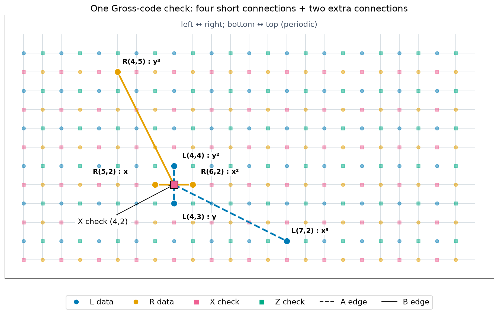
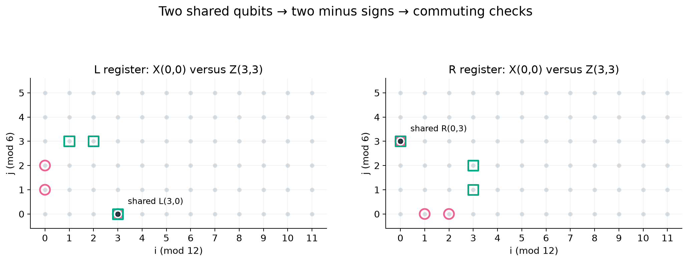
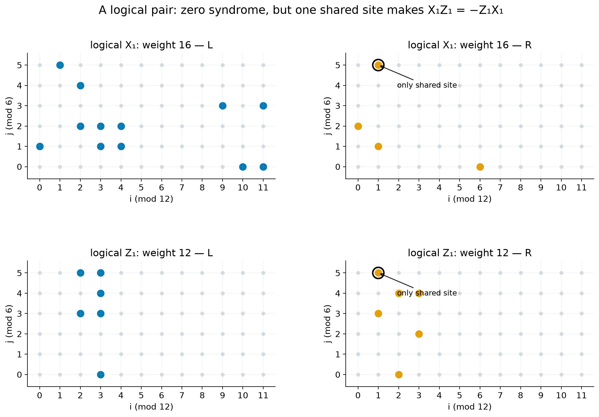
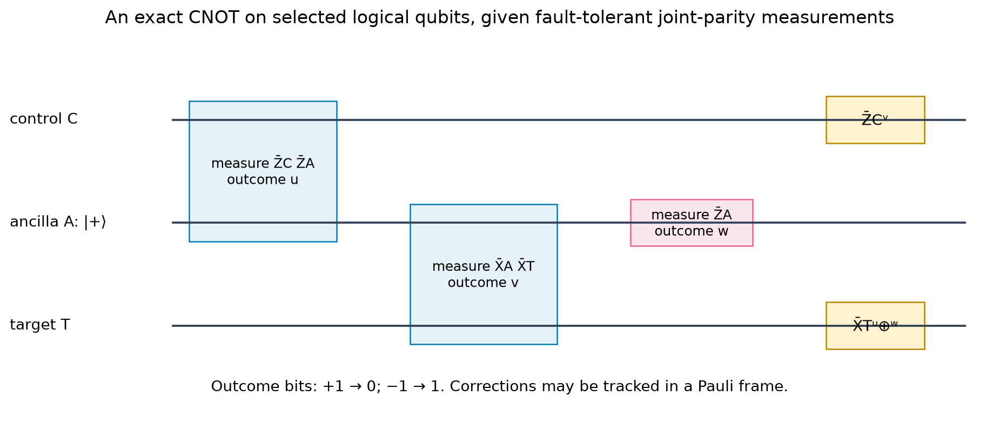

# Gross code: check patterns, logical operators, and computation

Status: Working notes
Last updated: 2026-10-13

## Overview

The Gross code stores twelve logical qubits in 144 data qubits, with distance twelve: $[[144,12,12]]$. Its original memory implementation adds 144 check ancillas, for 288 physical qubits. “Gross” means twelve dozen. The code belongs to the bivariate bicycle family introduced by IBM researchers in a 2023 preprint and published in 2024. [Original paper](https://www.nature.com/articles/s41586-024-07107-7)

This page assumes the stabilizers, logical operators, and syndrome measurements covered in the [basic QEC tutorial](../../qec_basic_notes/tut1.pdf). We focus on what changes when moving from a surface code to Gross code: the connections, the twelve logical qubits sharing one block, and the resulting gate and readout procedures.

## Check pattern recipes

There are two groups of data qubits, called $L$ and $R$. Each has a periodic $12\times6$ set of addresses:

$$
L(i,j),\quad R(i,j),\qquad i=0,\ldots,11,\quad j=0,\ldots,5.
$$

Increasing $i$ past 11 returns to 0; increasing $j$ past 5 also returns to 0. Thus there are $2\times12\times6=144$ data qubits. There is also one `X` check and one `Z` check per address.

We need a compact way to specify the six data qubits touched by each check. Let $x$ mean “increase the first address by one” and $y$ mean “increase the second address by one.” Define two **check pattern recipes**:

$$
A=x^3+y+y^2,\qquad B=y^3+x+x^2.
$$

**Algebraic addresses are not the drawn Cartesian positions.** The drawing interleaves four kinds of vertices: $L$ data, $R$ data, `X` checks, and `Z` checks. Consequently, increasing an address does not necessarily mean stepping to the next dot on the page. Follow the vertex labels when interpreting $x$ and $y$.

Each term selects one data qubit relative to the check's address. The plus signs collect these positions; they are not extra gates. An `X` check uses recipe $A$ in the $L$ group and recipe $B$ in the $R$ group:

$$
S_X(i,j)=X_{L(i+3,j)}X_{L(i,j+1)}X_{L(i,j+2)}
X_{R(i,j+3)}X_{R(i+1,j)}X_{R(i+2,j)}.
$$

For the corner check $S_X(0,0)$, the table below separates the **qubit address** selected by the recipe from its **position in Figure 1**. The drawing has columns 0–23 and rows 0–11, with rows counted upward from the bottom. Its placement rules are

$$
L(i,j)\longrightarrow(2i,2j-3),\qquad
R(i,j)\longrightarrow(2i-3,2j),
$$

wrapping drawing columns modulo 24 and drawing rows modulo 12. For example, $L(0,1)$ is placed at $(0,-1)$, which wraps to drawing position $(0,11)$; it is not the qubit address $L(0,11)$.

| Recipe | Term | Selected qubit address | Drawing position (column, row) |
| --- | --- | --- | --- |
| $A$ | $x^3$ | $L(3,0)$ | $(6,9)$ |
| $A$ | $y$ | $L(0,1)$ | $(0,11)$ |
| $A$ | $y^2$ | $L(0,2)$ | $(0,1)$ |
| $B$ | $y^3$ | $R(0,3)$ | $(21,6)$ |
| $B$ | $x$ | $R(1,0)$ | $(23,0)$ |
| $B$ | $x^2$ | $R(2,0)$ | $(1,0)$ |

The next **blue data qubit below** $L(0,1)$ is $L(0,0)$, at drawing position $(0,9)$, with a pink check between them at row 10. Continuing down the blue column gives addresses $L(0,5),L(0,4),L(0,3),L(0,2)$ at rows 7, 5, 3, and 1. These other blue sites orient the drawing; they are not additional data qubits selected by the corner check.



Blue and orange circles are $L$ and $R$ data; pink and green squares are `X` and `Z` checks. Dashed edges follow $A$, and solid edges follow $B$. The gray grid shows the short connections; other checks' extra connections are omitted for clarity.

The four non-cubic terms give four short connections in this drawing. Two of those cross the cut: the edge to $L(0,1)$ leaves at **a** and returns at **a**, while the edge to $R(1,0)$ leaves at **c** and returns at **c**. They are short on the periodic grid even though their endpoints appear on opposite sides of the rectangle. The cubic terms give the two extra connections, which also cross the cut here, at **b** and **d**.

The blue left and right boundaries are the same seam; the purple bottom and top boundaries are the other seam. Joining left to right makes a cylinder, and joining its two circular ends makes a torus. The inset represents the connectivity, not the physical shape required of a chip.

The same recipes work everywhere. For example, applying $A$ and $B$ at address $(11,5)$ selects $L(2,5),L(11,0),L(11,1),R(11,2),R(0,5),R(1,5)$: the address arithmetic wraps in both directions.

### The Z-check recipe and why it commutes with the X checks

To construct a `Z` check, exchange the recipes between $L$ and $R$ and reverse their shifts. Thus $x^3$ becomes a shift by minus three, and similarly for the other terms:

$$
S_Z(i,j)=Z_{L(i,j-3)}Z_{L(i-1,j)}Z_{L(i-2,j)}
Z_{R(i-3,j)}Z_{R(i,j-1)}Z_{R(i,j-2)}.
$$

All addresses are still periodic. Compare the corner `X` check with $S_Z(3,3)$:

| Check | $L$ data positions | $R$ data positions |
| --- | --- | --- |
| $S_X(0,0)$ | $(3,0),(0,1),(0,2)$ | $(0,3),(1,0),(2,0)$ |
| $S_Z(3,3)$ | $(3,0),(2,3),(1,3)$ | $(0,3),(3,2),(3,1)$ |

They share exactly $L(3,0)$ and $R(0,3)$. Exchanging `X` and `Z` on either shared qubit gives a minus sign; the two minus signs cancel.



There is also a simple reason this pairing works for **every** check. Suppose an `X` check is at address $u$, and a `Z` check is at address $v$. Use $a$ for one of the three shifts in $A$ and $b$ for one of the three shifts in $B$.

- A shared $L$ qubit has address $u+a=v-b$, so $v=u+a+b$.
- That same pair of shifts gives a shared $R$ qubit: $u+b=v-a$.

Every overlap in $L$ therefore has a matching overlap in $R$. For these particular recipes, the nine possible summed shifts $a+b$ are distinct even after wrapping, so any given `X`–`Z` check pair shares either zero or two data qubits. Either way, the checks commute. Reversing and exchanging the recipes is what guarantees this pairing. [Check construction](https://arxiv.org/html/2407.18393v2#S4)

Why choose these shifts rather than some other six connections? Commuting checks are only the first requirement. Different choices can store different numbers of logical qubits or admit short logical errors. These recipes and periodic dimensions were selected through a search for a useful combination of storage efficiency, protection, and hardware connectivity. The torus alone does not determine the parameters.

## Why there are twelve logical qubits

There are 72 `X` checks and 72 `Z` checks, but they do not impose 144 independent constraints. Some can be obtained by multiplying others. For the Gross pattern, only **66 checks of each type are independent**; there are six redundant relations in each set.

Using the stabilizer counting rule from the basic tutorial,

$$
\text{logical qubits}=144-66-66=12.
$$

The important Gross-specific point is that these twelve logical qubits occupy the **same block**. They are not twelve separate surface-code patches. Their logical operators can use overlapping sets of physical qubits, provided they have the appropriate commutation relations.

The counts come from checking dependencies among the actual stabilizer patterns, not from counting holes in the pictured torus. An ordinary toric code has two logical qubits; the Gross code's extra connections change the constraints. [Code-parameter calculation](https://arxiv.org/html/2308.07915#S4)

## What logical operators look like

A Gross logical operator is a pattern of physical Paulis that escapes all stabilizer checks but acts on encoded information. It need not resemble a single string running around the torus.

Here is one published logical `Z` pattern. Apply `Z` on these twelve data qubits:

| Group | Data addresses |
| --- | --- |
| $L$ | $(2,3),(2,5),(3,0),(3,3),(3,4),(3,5)$ |
| $R$ | $(1,3),(1,5),(2,0),(2,4),(3,2),(3,4)$ |

Its paired logical `X` uses the sixteen sites shown in the top row of the next figure. Every stabilizer has the required even overlap with the opposite-type logical pattern, so neither pattern creates a syndrome.



The two logical patterns share only $R(1,5)$, circled in black. Their odd overlap means they anticommute, as `X` and `Z` must for one logical qubit. It also proves these are not stabilizers: a stabilizer would commute with every pattern that escapes all checks. These representatives are given in equations (64)–(67) of [Cross et al.](https://arxiv.org/html/2407.18393v2#S4.SS1); we call the pair logical qubit 1.

### How to find a logical pattern

Conceptually, a search works by placing Pauli marks on data qubits and enforcing two conditions:

1. **No syndrome:** a candidate `Z` pattern must overlap every `X` check an even number of times; exchange `X` and `Z` for an `X` pattern.
2. **Nontrivial action:** discard patterns that are merely products of stabilizers. Those also have no syndrome, but do not change encoded information.

To find a paired `X`, require an odd overlap with the chosen logical `Z`. To find the other logical qubits, keep patterns whose action cannot be reproduced by multiplying the logical patterns already retained and the stabilizers. Pair them so that each logical `X` anticommutes with its own `Z` and commutes with the other eleven logical `Z` operators.

For 144 data qubits this is a computer calculation, not a practical exercise in guessing dots. The published pair above provides a concrete example whose overlaps can be checked directly; the [accompanying script](build_examples.py) verifies it and constructs a complete twelve-pair set.

Multiplying a logical representative by a stabilizer changes its physical pattern without changing its encoded action. Consequently there are many equivalent shapes. Finding a useful logical basis and finding the smallest representatives are separate tasks.

## Why the distance is twelve

The smallest nontrivial logical pattern touches twelve data qubits. The displayed logical `Z` supplies a twelve-qubit example, but that alone establishes only that the distance is **at most** twelve. To conclude that it is twelve, smaller nontrivial patterns must also be ruled out.

The original paper reports that this final distance calculation was performed using integer programming: a computer searches for the smallest pattern satisfying the no-syndrome and nontrivial-action requirements. It distinguishes that calculation from the faster heuristic searches used to screen code candidates. We rely on the paper for exclusion of smaller logical patterns; our examples verify the displayed twelve-qubit pattern. [Table 3 and Section 6](https://arxiv.org/html/2308.07915)

### Why twelve gives a five-error guarantee

If two error explanations each touch at most five data qubits, their difference touches at most ten. If they give the same syndrome, that difference is invisible to the checks. With distance twelve, it cannot be a nontrivial logical operator: the explanations must have the same encoded effect, and recovery can correct either.

Six errors cannot be guaranteed. Divide our twelve-site logical `Z` into two sets of six. Applying `Z` on the first set and applying it on the second set give the same syndrome, because their difference is the full logical `Z`. Yet the two explanations differ logically, so recovery cannot always distinguish them.

Thus distance twelve guarantees correction of up to five arbitrary data-qubit errors with ideal syndrome information and appropriate recovery. This is a general distance result, not an experimental performance claim for Gross code. [Quantum error-correction conditions](https://arxiv.org/html/quant-ph/9705052)

## A logical CNOT within one Gross block

To perform a CNOT from one chosen logical qubit to another, use the same logical measurement recipe as in the [surface-code tutorial](../../surface_code.ipynb): prepare an encoded ancilla in $|+\rangle_L$, measure two joint parities, then measure the ancilla and track corrections.

In the surface code, the control, target, and encoded ancilla occupy separate patches. In Gross code, their information shares the same 144 data qubits. Reserve one of the block's logical qubits as ancilla $a$; preparing it in $|+\rangle_L$ prepares that logical degree of freedom while preserving the other logical data.

### Prepare the logical ancilla and perform the measurements

For logical control $c$ and target $t$:

| Step | Operation | Outcome bit |
| --- | --- | --- |
| 1 | Prepare logical ancilla $a$ in $|+\rangle_L$ | — |
| 2 | Measure $\bar Z_c\bar Z_a$ collectively | $u$ |
| 3 | Measure $\bar X_a\bar X_t$ collectively | $v$ |
| 4 | Measure $\bar Z_a$ | $w$ |
| 5 | Track the corrections $\bar Z_c^{\,v}\bar X_t^{\,u\oplus w}$ | — |

A measured sign $+1$ means bit 0, and $-1$ means bit 1. Thus a logical `Z` correction on the control is needed when $v=1$, and a logical `X` correction on the target when $u$ and $w$ differ. These can be handled in the Pauli frame.

For **CNOT $1\to2$**, logical qubit 12 can fill the ancilla role in this logical recipe: prepare it in $|+\rangle_L$, measure $\bar Z_1\bar Z_{12}$, measure $\bar X_{12}\bar X_2$, and measure $\bar Z_{12}$. After the corrections, the operation on qubits 1 and 2 is CNOT. The encoded ancilla is consumed and can be reinitialized; the other logical data retain their information.



### Identify the physical qubits for each joint parity

Each logical operator is represented by a pattern of physical Paulis. To determine the physical observable for $\bar Z_c\bar Z_a$, multiply the two physical `Z` patterns. At a site shared by both, $Z_qZ_q=I$, so the factors cancel. Only sites occurring in exactly one pattern remain. Apply the same rule to the two `X` patterns for $\bar X_a\bar X_t$.

For example, multiplying physical patterns $Z_pZ_q$ and $Z_qZ_r$ gives

$$
(Z_pZ_q)(Z_qZ_r)=Z_pZ_r.
$$

This small example illustrates cancellation, rather than actual Gross logical supports. For the representatives in our accompanying calculation, $\bar Z_1$ has twelve sites and $\bar Z_{12}$ has twenty-four, with three shared sites. Their joint observable therefore has thirty physical `Z` factors: $12+24-2\times3=30$. That is the size of this chosen operator pattern, not the physical gate count of a protected implementation.

Measure the resulting **product collectively**. An outcome $+1$ for $\bar Z_1\bar Z_{12}$ says the logical `Z` values agree; $-1$ says they differ. It does not distinguish $|00\rangle_L$ from $|11\rangle_L$, or $|01\rangle_L$ from $|10\rangle_L$, so coherence within either parity group is preserved. Measuring the two logical values separately, or reading every marked data qubit individually, would reveal extra information and would not implement the required measurement.

### Use physical auxiliaries to collect and protect the parity

The **encoded ancilla** $a$ participates in the logical CNOT recipe. Additional **physical measurement auxiliaries** collect the parity; they have a different role.

The simplest ideal circuit for a physical `Z` product prepares a measurement ancilla $m$ in $|0\rangle$, applies a CNOT from each marked data qubit to $m$, and measures $m$ in `Z`. The ancilla accumulates just the combined parity. For an `X` product, prepare $m$ in $|+\rangle$, apply CNOTs from $m$ to the marked data qubits, and measure $m$ in `X`.

These circuits explain how the selected physical factors enter the measurement, but a single ancilla interacting sequentially with many data qubits can spread faults. A protected Gross implementation instead uses an auxiliary network and small modified checks whose product equals the desired logical parity. As in surface-code surgery, it measures and decodes these checks over repeated rounds, measures out the auxiliary qubits, restores the original code, and tracks the associated corrections. [Protected logical-measurement construction](https://arxiv.org/html/2407.18393v2#S4)

The additional parity-measurement interactions are determined by the chosen physical operator and auxiliary network. Routine error checks still run across the block. Compiled code-preserving permutations may also involve more data qubits, so the total physical gate count depends on the full protected circuit. This procedure is not a blanket CNOT between every matching data pair in two blocks.

The compact published hardware provides a limited set of logical measurement ports. Requested parities for other logical combinations are compiled using those measurements and physical permutations that preserve the code. Its synthesis scheme reserves one of the twelve logical qubits as ancilla, leaving eleven logical data qubits for computation. The recipe above specifies the requested logical CNOT; a protected physical schedule for the particular pair $1\to2$ has not been compiled in these notes. [Gross-code computing architecture](https://arxiv.org/html/2506.03094v1#S2.SS3)

## Reading out logical data

For final readout in the `Z` basis, measure all 144 data qubits in `Z`. For each logical `Z`, multiply the measured signs on its marked sites. For the twelve-site example,

$$
\bar z_1^{\rm raw}=\prod_{q\ \text{in the logical pattern}}m_q,
\qquad m_q\in\{+1,-1\}.
$$

The individual outcomes can be random even for a known encoded computational-basis state; the collective parities give the twelve logical results. The decoder uses the preceding syndrome history and compatible final check parities to decide which raw logical results need flipping. No physical corrections are required after this destructive readout. Whole-block `X` readout works in the corresponding basis.

To read one logical qubit while preserving the others, use the collective auxiliary measurement described above. Measuring every physical qubit on its support individually would reveal more information than the chosen logical parity. [Logical measurement protocols and whole-block readout](https://arxiv.org/html/2506.03094v1)

### A single-error readout example

Prepare all twelve logical qubits in $|0\rangle_L$. Every correct logical `Z` result is then $+1$. Now inject `X` on $R(1,5)$, the circled site of our logical pair.

The reversed `Z` recipe shows that this data qubit participates in exactly these checks:

$$
S_Z(1,0),\qquad S_Z(1,1),\qquad S_Z(4,5).
$$

All three signs flip. Because $R(1,5)$ belongs to the displayed logical `Z` pattern, its raw readout parity also flips to $-1$. In this noiseless-syndrome, single-error example, exactly one data-qubit `X` error explains the three changed checks: the error at $R(1,5)$. The decoder flips the raw logical answer back to $+1$.

With noisy check measurements and continuing data errors, we need the repeated history rather than this single-round lookup. This is the same distinction emphasized in the [decoding tutorial](../../decoder.ipynb).

## Why the required connections are hard to build

A periodic drawing declares two opposite edges adjacent. A flat chip still has to carry the interaction between those physical locations. The extra bulk connections pose the same problem: their microwave paths must pass other qubits, couplers, and control lines.

| Hardware issue | Why it affects the code |
| --- | --- |
| Crossing routes | Independent microwave paths cannot simply intersect as joined metal wires. They need bridges, shielding, vias, or routing layers. |
| Added loss | Longer structures and extra interfaces can expose the quantum state to more imperfect material, reducing coherence or gate quality. |
| Unwanted interactions | Couplers and control pulses can affect other qubits, producing crosstalk and correlated errors during parallel checks. |
| Extra modes and frequency constraints | Long microwave structures have electromagnetic modes that must be engineered alongside qubit and gate frequencies. |
| Indirect routing | Replacing a direct gate with SWAPs or a measurement-based connection adds operations, latency, and sometimes ancillas. |

The difficulty is not that a long-range gate is fundamentally impossible. It is making all required interactions reliable and fast enough throughout repeated error-check cycles. One detailed Gross-code routing study uses the qubit tier plus four higher tiers under its chosen layout constraints; that is an example of engineering overhead, not a universal layer requirement. [Multilayer hardware study](https://arxiv.org/html/2507.23011)

Code distance also does not count faulty circuit operations. An ancilla fault can spread through several data interactions, so gate order and correlated faults matter. The original Gross extraction circuit has a reported circuit-distance upper bound of ten despite code distance twelve. The five-data-error guarantee therefore cannot be read as a five-circuit-fault guarantee. [Original circuit analysis](https://arxiv.org/html/2308.07915)

IBM reports progress toward the required connectivity, routing layers, long couplers, and reset components. These component results do not by themselves establish the full original Gross-code memory experiment. The primary sources checked for these notes do not report a demonstration of that full memory. [IBM engineering update](https://www.ibm.com/quantum/blog/qdc-2025); [March 2026 device overview](https://research.ibm.com/publications/toward-realization-of-quantum-ldpc-devices)

## Further study and reproducible examples

The next useful step is to follow one named control–target pair through the published protected auxiliary system and its physical gate schedule. This would connect the parity-measurement picture to actual time and qubit costs. It is not yet worked through here.

The [example script](build_examples.py) reproduces the figures, checks all stabilizer overlaps and twelve logical pairs, verifies every outcome branch of the CNOT gadget, and runs the single-error readout example. It does not reproduce the paper's full distance lower-bound computation or simulate noisy fault-tolerant operation. Run it from the repository root with:

```bash
.venv/bin/python qec_knowledge_base/gross-code/build_examples.py
```

Useful connections to the basic material:

- [Shor-code notebook](../../shor_tutorial.ipynb): independent stabilizers, logical pairs, and tracked corrections.
- [Surface-code and lattice-surgery notebook](../../surface_code.ipynb): the joint-parity measurement idea behind logical gates.
- [Decoding notebook](../../decoder.ipynb): correcting a logical answer using syndrome history rather than trying to observe the encoded state directly.

## References

1. Sergey Bravyi et al., [*High-threshold and low-overhead fault-tolerant quantum memory*](https://www.nature.com/articles/s41586-024-07107-7), *Nature* 627, 778–782 (2024). [Expanded arXiv version](https://arxiv.org/html/2308.07915): code construction, distance calculation, and extraction circuits.
2. Daniel Gottesman, [*Stabilizer Codes and Quantum Error Correction*](https://arxiv.org/html/quant-ph/9705052) (1997): general recovery guarantees and CSS gate constructions.
3. Andrew Cross et al., [*Improved QLDPC Surgery: Logical Measurements and Bridging Codes*](https://arxiv.org/html/2407.18393v2): explicit Gross logical patterns and protected logical measurement schemes.
4. Theodore Yoder et al., [*Tour de gross: A modular quantum computer based on bivariate bicycle codes*](https://arxiv.org/html/2506.03094v1) (2025): Gross-code computing instructions, auxiliary systems, and physical schedules.
5. Melvin Mathews et al., [*Placing and routing quantum LDPC codes in multilayer superconducting hardware*](https://arxiv.org/html/2507.23011): physical routing constraints and example layouts.
