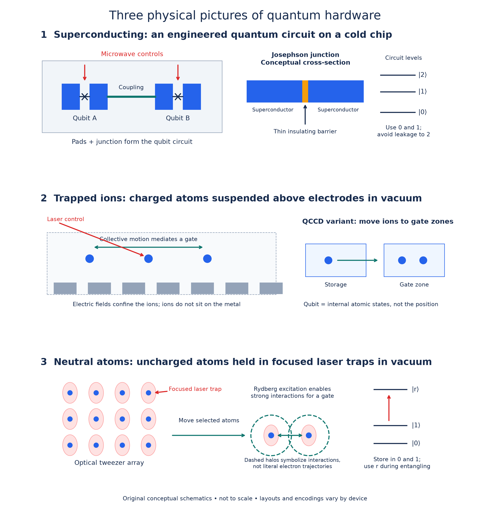

# Quantum computing hardware: physical qubits, controls, and connectivity

Status: Draft
Last updated: 2026-10-14

## Overview

This page begins with one question: **what physical system do we need in order to build a quantum computer?** We then build a visual picture of superconducting qubits, trapped ions, and neutral atoms, and compare how their structures affect native operations, interacting pairs, and present experimental capabilities.

This is the opening section of an evolving study page. Detailed pulse physics, device Hamiltonians, and logical-gate engineering remain future discussion topics. The current scope is universal, gate-based computation and its connection to QEC. Analog quantum simulators and annealers use different programming models; a hardware material alone does not identify the model. [D-Wave documentation](https://docs.dwavequantum.com/en/latest/index.html)

A useful prerequisite is the [introduction to quantum computing](../../qec_basic_notes/tut0.pdf). The [QEC tutorial](../../qec_basic_notes/tut1.pdf) explains why hardware quality matters once information is encoded into logical qubits.

## Basic intuitions

### 1. Two classical states are not enough

A **classical bit** stores one of two distinguishable values. A **qubit** uses two orthogonal quantum states, written $|0\rangle$ and $|1\rangle$, and supports coherent superpositions

$$
|\psi\rangle=\alpha|0\rangle+\beta|1\rangle,
\qquad |\alpha|^2+|\beta|^2=1.
$$

Here $\alpha$ and $\beta$ are complex probability amplitudes. Their relative phase matters: changing it can change the outcome after a later gate. A classical random choice between zero and one has probabilities but does not preserve this coherent phase relationship.

We therefore need to preserve coherence and manipulate it predictably. Interference happens when controlled operations recombine amplitudes. With multiple qubits, the controls must also create entanglement: joint states that cannot be written as independent states of each qubit. Entanglement alone does not establish a useful computer; we also need initialization, controlled operations, and readout.

The physical object **does not have to possess exactly two energy levels**. We need a well-defined two-dimensional computational subspace. Atoms have many states; superconducting circuits also have additional levels. Occupying states outside the chosen subspace is called **leakage**. In some gate protocols, additional levels are intentionally used temporarily and the population is returned to the computational subspace.

### 2. General requirements for gate-based quantum computing

The standard starting point is the five DiVincenzo criteria, paraphrased below. They describe capabilities; they do not prescribe a particular material or device shape. [DiVincenzo](https://arxiv.org/abs/quant-ph/0002077)

| Requirement | Physical meaning |
| --- | --- |
| Scalable, well-characterized qubits | Know the computational states and relevant interactions; have a path to larger controlled systems. |
| Initialization | Prepare a known reference state reliably. |
| Sufficiently long coherence | Preserve information relative to the time required for operations. |
| Universal gate control | Combine available operations to approximate arbitrary quantum circuits. |
| Qubit-specific measurement | Extract the required qubit outcomes reliably. |

Quantum communication adds the ability to convert between stationary and travelling qubits, and to transmit travelling qubits faithfully. Those capabilities become relevant for networked modules, rather than being mandatory for every stand-alone processor. [DiVincenzo](https://arxiv.org/abs/quant-ph/0002077)

For a scalable **fault-tolerant** machine, we must further ask whether these capabilities work reliably together: repeated checks, measurement and reset during computation, classical decoding, and feedback when a protocol needs it. Gates, idling, measurement, leakage, loss, and correlated errors all contribute to the result. There is no universal minimum coherence time in seconds, nor a single platform-independent fidelity threshold. The appropriate comparison depends on operation durations, noise, the code, and its circuits.

This creates the central engineering tension: **isolate a qubit enough to preserve its state, but couple to it enough to control, entangle, and measure it.**

### 3. What should I imagine when I hear each platform name?

These are original explanatory drawings, not photographs, fabrication drawings, or measured device layouts. Sizes are not to scale. The [editable SVG](assets/platform-schematics.svg) and [figure-generation script](build_figures.py) are included.

**Superconducting qubits — imagine a patterned chip inside a dilution refrigerator.** A common example is a transmon: a capacitor shunting a Josephson junction. The junction introduces nonlinearity, giving unequally spaced circuit energy levels so we can selectively control the lowest two. The qubit is the quantum state of the circuit, not the junction alone. [Superconducting-qubit explanation](https://www.nature.com/articles/s41534-016-0004-0)

A typical tunnel Josephson junction is **superconductor–insulator–superconductor**, often aluminium–oxide–aluminium. Cooper pairs tunnel coherently through the barrier. It is fabricated as a small junction, but its operating principle differs from a silicon p–n diode. Other Josephson weak-link designs exist. [Josephson-junction physics](https://www.nature.com/articles/s41567-024-02400-8)

**Trapped ions — imagine individual charged atoms suspended in vacuum above or between electrodes, with laser beams addressing them.** The electric trap confines their motion; two internal atomic states store the qubit. Collective motion can mediate entangling gates. In transport architectures, electrodes also move ions between storage and operation zones. The ion's position is a routing resource, not the usual computational bit value. [Helios hardware description](https://docs.quantinuum.com/systems/user_guide/hardware_user_guide/helios.html)

**Neutral atoms — imagine a camera image of an array of bright dots, each an atom held by a focused laser trap.** These traps are optical tweezers. Two internal states usually store the qubit. Excitation to a highly excited Rydberg state makes interactions strong enough to entangle selected atoms; tweezers can rearrange the array. The atoms do not sit in a solid chip lattice. [Optical-tweezer review](https://www.nature.com/articles/s41567-021-01357-2), [Rydberg gate experiment](https://www.nature.com/articles/s41586-023-06481-y)

### 4. How physical structure affects gates and connectivity

A **native gate** is an operation directly supported by the device's calibrated control scheme. A **compiled gate** combines native operations to realize the requested circuit operation. Some native instructions, such as a virtual $Z$ rotation, are implemented by changing a control reference phase rather than applying a separate physical pulse.

**Connectivity** identifies which pairs can perform an entangling operation and how that access is achieved. A fixed connection, movement-enabled access, and an optical link have different timing and scheduling costs. Any-pair access does not imply that every pair can operate simultaneously.

The entries below describe representative implementations, not rules that every device in a platform must follow.

| Platform | Physical control and entangling mechanism | Representative native operations | Which pairs can interact? | Why it matters; main engineering costs |
| --- | --- | --- | --- | --- |
| Superconducting circuits | Microwave drives control circuit states; fabricated couplings and sometimes tunable couplers enable entangling pulses. | Single-qubit rotations and virtual $Z$ updates; current IBM Heron/Nighthawk use $CZ$. Other designs use ECR or exchange-type gates. [IBM instructions](https://quantum.cloud.ibm.com/docs/en/guides/qpu-information) | Usually the edges of the engineered coupling graph. Distant states need routing or additional engineered links. | Fast operations and integrated fabrication; coherence, cryogenic control, calibration, crosstalk, and wiring constrain scaling. |
| Trapped ions | Laser or microwave controls address internal states; commonly, state-dependent forces couple spins through shared motion. | Rotations and motion-mediated entanglers. Helios exposes $R_{xy}$, virtual $R_z$, and $R_{ZZ}(\theta)$. [Helios gates](https://docs.quantinuum.com/systems/user_guide/hardware_user_guide/helios.html) | Shared-mode access within an ion register; QCCD systems can transport selected ions to gate zones. Access across modules requires further interconnects. | Precise control and flexible pair access; motion management, transport, optical control, and available gate zones affect time and parallelism. |
| Neutral atoms | Optical/microwave controls rotate internal states; Rydberg excitation enables strong, state-dependent interactions. | Single-qubit rotations and Rydberg controlled-phase gates such as $CZ$ in representative gate-based systems. [Gate experiment](https://www.nature.com/articles/s41586-023-06481-y) | Depends on separation and the gate protocol. Moving tweezers can bring chosen pairs into gate configurations. | Large rearrangeable arrays and parallel gates; loss, reloading, readout, optical stability, and movement must be managed. |

Our study priority is these three platforms because they offer complementary examples of integrated circuits, motion-mediated atomic gates, and programmable spatial arrays. This is a pedagogical choice, not a definitive ranking. Semiconductor spins and photonics are also substantial research directions. [Silicon spin devices](https://www.nature.com/articles/s41586-025-09531-9), [modular photonics](https://www.nature.com/articles/s41586-024-08406-9)

### 5. Where are we now? A dated milestone snapshot

**Sources checked on 2026-10-14.** This table selects informative demonstrated milestones; it is not an exhaustive record leaderboard. Research experiments and accessible processor specifications are listed separately from the capability they establish. Roadmap targets are not treated as achieved results.

| Platform | Selected demonstrated or available capability | What it establishes | What the entry does not establish |
| --- | --- | --- | --- |
| Superconducting: Google Willow | A 105-qubit processor demonstrated surface-code memories with logical error suppression as distance increased, including a distance-7 memory; published in *Nature* in 2025. [Paper](https://www.nature.com/articles/s41586-024-08449-y) | Evidence that repeated QEC can improve a logical memory as the code grows under the tested conditions. | A large universal fault-tolerant computer or arbitrary long logical algorithms. |
| Superconducting: IBM | Current documentation lists Heron at 156 qubits and Nighthawk with 120 programmable qubits. Nighthawk r2 is dated September 2026 and includes high-speed reset. [Processor documentation](https://quantum.cloud.ibm.com/docs/en/guides/processor-types) | Engineered gate-based processors with different coupling layouts and operational features. | Those counts are not counts of error-corrected logical qubits. IBM separately lists 458 physical qubits for r2; this page uses the explicitly programmable count. |
| Trapped ions: Quantinuum Helios | The November 2025 preprint reports 98 qubits, transport-enabled all-to-all connectivity, and average two-qubit infidelity $7.9(2)\times10^{-4}$ across operation zones, equivalent to about 99.921% fidelity. [Preprint](https://arxiv.org/abs/2511.05465) | A substantial gate-based system combining precise operations, routing, and dynamic control. | Component fidelity is not the success probability of an entire algorithm; flexible pair access is not unlimited parallelism. |
| Neutral atoms: reconfigurable logical processor | A study published online in November 2025, appearing in *Nature* 649 (2026), uses up to 448 atoms for repeated QEC, logical operations, and mid-circuit reuse. Its abstract reports a $2.14(13)$ suppression factor in a four-round below-threshold characterization. [Paper](https://www.nature.com/articles/s41586-025-09848-5) | Experimental integration of important fault-tolerant processing mechanisms. | Unconditional performance for arbitrary computations; interpretation depends on the tested circuits, decoding, and acceptance conditions. |
| Neutral atoms: array scaling | A separate 2025 experiment reports more than 6,100 trapped atoms and 12.6(1) s coherence under its protocol. [Paper](https://www.nature.com/articles/s41586-025-09641-4), [author-hosted record](https://authors.library.caltech.edu/records/t3nx5-rsp96) | Large coherent arrays are experimentally possible. | A 6,100-qubit universal entangling processor or 6,100 logical qubits. This is a different experiment from the 448-atom logical processor. |

The evidence shows progress in distinct dimensions: physical scale, gate quality, routing, and logical error suppression. Raw qubit counts cannot combine those dimensions into a fair comparison. For QEC, the decisive question is how much **reliable logical storage and computation** the complete system supplies, at what space and time cost.

## Formal descriptions

### Computational subspace and physical evolution

For one physical device with Hilbert space $\mathcal H_{\mathrm{physical}}$, choose

$$
\mathcal H_q=\operatorname{span}\{|0\rangle,|1\rangle\}
\subseteq\mathcal H_{\mathrm{physical}}.
$$

The physical Hamiltonian $H(t)$ describes energies, interactions, and applied controls. It produces

$$
U(t)=\mathcal T\exp\!\left[-\frac{i}{\hbar}\int_0^t H(s)\,ds\right],
$$

where $\mathcal T$ denotes time ordering and $\hbar$ is the reduced Planck constant. For a coherent gate, we engineer this evolution to match the desired operation on $\mathcal H_q$, with acceptably small residual leakage and noise. Measurement, reset, and measurement-assisted protocols require a more general description than unitary evolution alone.

For the usual circuit model, arbitrary single-qubit rotations plus a suitable entangling two-qubit gate provide universal control. We do not require a separate physical mechanism for every named circuit gate. Alternative encodings and measurement-based constructions realize universality in other ways. [DiVincenzo](https://arxiv.org/abs/quant-ph/0002077)

### Coherence and operational errors

$T_1$ characterizes energy relaxation, while $T_2$ characterizes decay of coherence between the computational states. Reported coherence times depend on the experimental protocol; for example, echo or dynamical decoupling can change the measured lifetime. They must be compared with the durations and idle periods of the intended computation.

For intuition only, a Markovian decay contribution over a short interval $t$ can scale like $1-e^{-t/T}\approx t/T$. This is not a general gate-fidelity formula: control errors, leakage, crosstalk, and correlated faults can dominate. We have not yet developed platform-specific noise models in this discussion.

## Worked examples

### A compiled CNOT from a native CZ

Let $c$ be the control and $t$ the target, $I$ the identity, $H$ the Hadamard gate, and $CZ=\operatorname{diag}(1,1,1,-1)$ in the basis $|00\rangle,|01\rangle,|10\rangle,|11\rangle$.

$$
\mathrm{CNOT}_{c\to t}
=(I_c\otimes H_t)\,CZ_{ct}\,(I_c\otimes H_t).
$$

Read operations from right to left. When the control is zero, $CZ$ applies $I$ to the target and $HIH=I$. When it is one, $CZ$ applies $Z$ to the target and $HZH=X$, giving the required conditional flip. The Hadamards can themselves be compiled into native rotations. This identity shows why native $CZ$ control can implement a circuit requesting CNOT.

### Pair access has a physical cost

Consider a fixed chain $A-B-C$ with only nearest-neighbour entangling gates. To apply a gate between the states initially stored at $A$ and $C$, one possible construction is:

1. SWAP the states at $A$ and $B$.
2. Apply the requested gate between $B$ and $C$.
3. SWAP $A$ and $B$ back if the original mapping is required.

In a CNOT-based decomposition, each SWAP uses three CNOTs, so this construction adds six CNOTs. A compiler may retain the new mapping and avoid the return SWAP, or use another construction. This is an illustrative routing cost, not an experimentally measured schedule.

Movable-ion or movable-atom hardware may instead transport the carriers to a gate region. Physical movement is different from applying a quantum SWAP; it has its own duration, heating or loss risks, and scheduling constraints.

## Limitations

- The schematics depict representative mechanisms. They omit many electrodes, optical components, readout structures, cooling ions, and control lines.
- Native instructions and pair access must be checked for the particular device and revision. A platform name does not uniquely specify them.
- The milestone snapshot records selected sources checked on the stated date. It does not certify an absolute latest record in every category.
- Different fidelity benchmarks, isolated versus parallel operation, acceptance/postselection rules, and code distances make numerical rankings hazardous. The table does not rank platforms by a shared benchmark.
- Logical-qubit counts require context: encoded storage, error detection, repeated error correction, and universal logical computation are different demonstrated capabilities.
- Detailed hardware mechanisms and performance estimates beyond the opening overview remain undeveloped.

## Open questions

Questions to carry forward from this study discussion:

1. How does a Josephson junction make a circuit's levels unequal, and how does a microwave pulse become a gate?
2. How does shared ion motion entangle internal states while returning the motion to a suitable condition?
3. How does Rydberg blockade produce a conditional phase, and how does separation constrain that gate?
4. How should we compare native gates, transport, measurement, and reset in the time budget of a QEC cycle?
5. Which connectivity and noise features favour surface codes versus codes such as the Gross code?

These are learning questions for later sections, not claims that each question is unresolved research.

## Related topics

- [Quantum computing introduction](../../qec_basic_notes/tut0.pdf): states and abstract gates whose physical implementation is the subject here.
- [QEC tutorial](../../qec_basic_notes/tut1.pdf): encoding and syndrome extraction require reliable hardware operations.
- [Gross code](../gross-code/README.md): its extra connections illustrate why abstract check graphs must be translated into physical routes and protected schedules.
- [Surface-code and lattice-surgery notebook](../../surface_code.ipynb): the repository describes local checks and joint logical parity measurements; hardware determines the cost of their underlying operations.
- Detailed transmon, ion-gate, and Rydberg-gate studies: **Planned; no separate pages yet.**

## References

1. David P. DiVincenzo, [*The Physical Implementation of Quantum Computation*](https://arxiv.org/abs/quant-ph/0002077) (2000): implementation criteria.
2. Jay M. Gambetta, Jerry M. Chow, and Matthias Steffen, [*Building logical qubits in a superconducting quantum computing system*](https://www.nature.com/articles/s41534-016-0004-0) (2017): circuit levels and superconducting control.
3. Dennis Willsch et al., [*Observation of Josephson harmonics in tunnel junctions*](https://www.nature.com/articles/s41567-024-02400-8) (2024): junction physics and transmon circuits.
4. IBM, [*Processor types*](https://quantum.cloud.ibm.com/docs/en/guides/processor-types) and [*View backend details*](https://quantum.cloud.ibm.com/docs/en/guides/qpu-information): current device families and instruction information; checked 2026-10-14.
5. Google Quantum AI and Collaborators, [*Quantum error correction below the surface code threshold*](https://www.nature.com/articles/s41586-024-08449-y) (online 2024; volume 2025).
6. Anthony Ransford et al., [*Helios: A 98-qubit trapped-ion quantum computer*](https://arxiv.org/abs/2511.05465) (2025 preprint); Quantinuum [*Helios Operation*](https://docs.quantinuum.com/systems/user_guide/hardware_user_guide/helios.html), checked 2026-10-14.
7. Adam M. Kaufman and Kang-Kuen Ni, [*Quantum science with optical tweezer arrays of ultracold atoms and molecules*](https://www.nature.com/articles/s41567-021-01357-2) (2021).
8. Simon J. Evered et al., [*High-fidelity parallel entangling gates on a neutral-atom quantum computer*](https://www.nature.com/articles/s41586-023-06481-y) (2023).
9. [*A fault-tolerant neutral-atom architecture for universal quantum computation*](https://www.nature.com/articles/s41586-025-09848-5) (online 2025; volume 2026).
10. [*A tweezer array with 6,100 highly coherent atomic qubits*](https://www.nature.com/articles/s41586-025-09641-4) (2025); [author-hosted publication record](https://authors.library.caltech.edu/records/t3nx5-rsp96).
11. [*Industry-compatible silicon spin-qubit unit cells exceeding 99% fidelity*](https://www.nature.com/articles/s41586-025-09531-9) and [*Scaling and networking a modular photonic quantum computer*](https://www.nature.com/articles/s41586-024-08406-9) (2025): additional platforms beyond this opening section.
12. D-Wave, [documentation](https://docs.dwavequantum.com/en/latest/index.html): gate-model versus annealing programming models.
