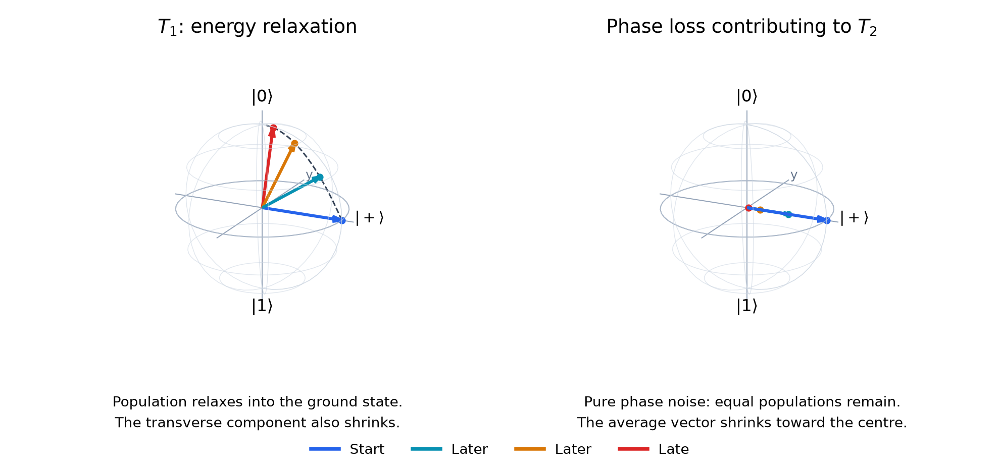
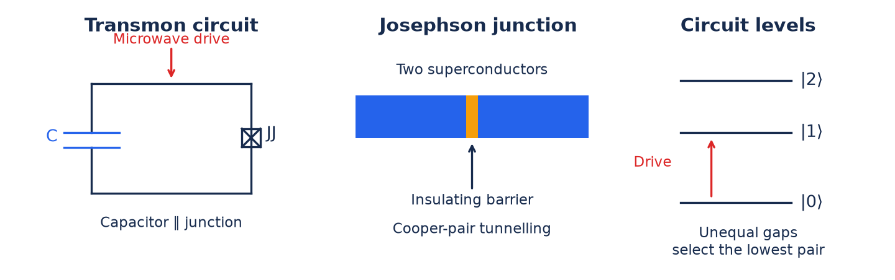
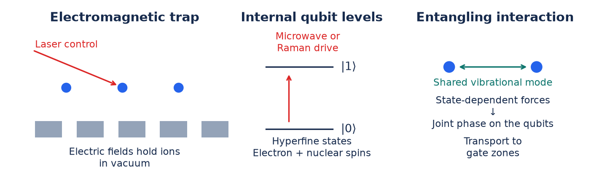
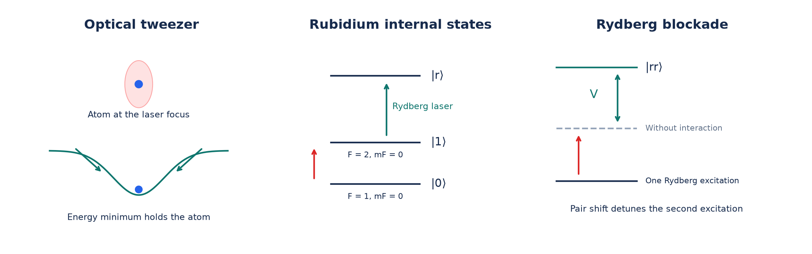

# Quantum computing hardware

Last updated: 2026-10-14

## Overview

A qubit can be in a superposition

$$
|\psi\rangle=\alpha|0\rangle+\beta|1\rangle,
\qquad \alpha,\beta\in\mathbb C,
\qquad |\alpha|^2+|\beta|^2=1.
$$

The amplitudes set the measurement probabilities, $P(0)=|\alpha|^2$ and $P(1)=|\beta|^2$. Their **relative phase**, $\arg\beta-\arg\alpha$, determines how the two components interfere during later gates.

**Atoms, ions, and electron spins provide natural two-level systems.** Neutral atoms and ions have discrete internal energy levels. For two chosen levels with energies $E_0$ and $E_1$, a superposition evolves as

$$
\begin{aligned}
|\psi(t)\rangle
&=\alpha e^{-iE_0t/\hbar}|0\rangle
+\beta e^{-iE_1t/\hbar}|1\rangle\\
&=e^{-iE_0t/\hbar}
\left(\alpha|0\rangle+\beta e^{-i\Delta E\,t/\hbar}|1\rangle\right),
\qquad \Delta E=E_1-E_0.
\end{aligned}
$$

Here $\hbar=h/(2\pi)$, with $h$ Planck's constant. The common factor $e^{-iE_0t/\hbar}$ is a **global phase** and does not affect measurement probabilities. The energy difference determines the evolving relative phase:

$$
\varphi(t)=\varphi(0)-\frac{\Delta E\,t}{\hbar}.
$$

A resonant electromagnetic drive couples the levels and prepares a chosen superposition. Electron spins follow the same description when a magnetic field separates the energies of spin up and spin down.

**Using these states as qubits requires protecting them from their surroundings.** Collisions with air, fluctuating fields, and coupling to uncontrolled motion can exchange energy or disturb the relative phase. When the environment acquires information that distinguishes the components of a superposition, their observable interference is lost. This is **decoherence**. Cooling reduces thermal excitation and unwanted motion. Vacuum, shielding, and controlled fields reduce other disturbances.

**The goal of quantum computing hardware is to select two addressable states, suppress unwanted interactions, and provide controlled coupling for gates and readout.** Trapped ions and neutral atoms use internal atomic states. Superconducting qubits use discrete levels of an engineered electrical circuit. In either case, populations and phase information must survive long enough to perform many operations.

### Relaxation and phase stability

Two time scales quantify this survival: **$T_1$ measures energy relaxation**, which changes the populations, and **$T_2$ measures the decay of phase coherence**, which reduces interference. Both can be visualized on the Bloch sphere.

On the Bloch sphere introduced in Tutorial 0, the north pole is $|0\rangle$ and the south pole is $|1\rangle$. The height encodes the population difference, and the angle around the vertical axis encodes the relative phase. Noise can shorten the Bloch vector, moving its tip inside the sphere.

| Time scale | Physical change | Bloch-sphere picture |
| --- | --- | --- |
| $T_1$: energy relaxation | The excited-state population decays as the qubit releases energy. | For relaxation to the ground state, the vector approaches the north pole. |
| $T_2$: loss of phase coherence | Phase fluctuations wash out interference across repeated runs. Energy relaxation also contributes. | The component in the equatorial plane shrinks. Pure phase noise leaves the height unchanged. |

For relaxation toward $|0\rangle$ and simple exponential decay,

$$
p_1(t)=p_1(0)e^{-t/T_1},
\qquad
r_\perp(t)=r_\perp(0)e^{-t/T_2},
$$

where $r_\perp$ is the length of the Bloch vector's projection onto the equatorial plane. The figure starts both examples at $|+\rangle=(|0\rangle+|1\rangle)/\sqrt2$, with equal populations and relative phase zero. The vectors show the state averaged over repeated runs, with predictable phase rotation omitted. Compare $T_1$ and $T_2$ with gate and idle durations to judge how much information is lost during a computation.

## Requirements for gate-based quantum computing

The five **DiVincenzo criteria** specify the essential capabilities. [Original paper](https://arxiv.org/abs/quant-ph/0002077)

| Requirement | Hardware capability |
| --- | --- |
| Scalable, well-characterized qubits | Known states and interactions, with a route to larger systems. |
| Initialization | Prepare a known state. |
| Long enough coherence | Preserve information over the required operations. |
| Universal gate control | Combine operations to approximate arbitrary quantum circuits. |
| Qubit-specific measurement | Read the required qubit outcomes. |

Fault-tolerant computation adds repeated error checks, reset, decoding, and feedback. Storage favours isolation. Gates and measurement require carefully controlled coupling.

## Superconducting qubits

A **Josephson junction** consists of two superconductors separated by a thin insulating barrier. Cooper pairs tunnel coherently across it, producing a current that depends on the superconducting phase difference $\phi$:

$$
I=I_c\sin\phi.
$$

Here $I_c$ is the critical current. This nonlinear, nondissipative response lets the junction act as a nonlinear inductive element. Connecting it in parallel with a large capacitor gives a **transmon**, operated with $E_J\gg E_C$. The capacitor stores charge energy, and the junction provides the phase-dependent energy. With $h$ the Planck constant and $\hbar=h/(2\pi)$, its Hamiltonian, neglecting offset charge, is

$$
H=4E_C n^2-E_J\cos\phi,
\qquad E_C=\frac{e^2}{2C},
\qquad E_J=\frac{\hbar I_c}{2e}.
$$

$n$ is the number of excess Cooper pairs, $C$ is capacitance, $e$ is the elementary charge, and $E_J$ is the junction's coupling energy. Charge and phase are conjugate quantum variables, like momentum and position. Their dynamics produces discrete oscillator levels. The cosine potential makes the spacing unequal:

$$
E_2-E_1\ne E_1-E_0.
$$

A drive at $(E_1-E_0)/h$ can address the lowest pair without resonantly driving the next transition. These levels form the qubit. Low-loss superconducting materials and operation at tens of millikelvin let this electrical mode retain phase information and suppress thermal excitation. [Transmon review](https://arxiv.org/abs/0812.1865), [Circuit review](https://arxiv.org/abs/2006.10433)

**Control:** microwave pulse strength and duration set the rotation angle. Pulse phase sets the rotation axis. A readout resonator converts the qubit state into a measurable microwave response. Leaving the lowest pair is **leakage**. [Control and readout](https://www.nature.com/articles/s41534-016-0004-0)

## Trapped ions

Electromagnetic fields hold charged atoms in vacuum. Their bound electrons and nuclear spin provide discrete internal levels. A common qubit uses two **hyperfine states**, with different configurations of the coupled electron and nuclear angular momenta. The trap controls position, while these internal states store $|0\rangle$ and $|1\rangle$.

**Control:** microwaves or a pair of lasers coherently drive the selected transition. In a Raman drive, the lasers' frequency difference matches the qubit splitting. Pulse strength, duration, and phase control the resulting superposition. Laser cooling reduces motion, and high vacuum suppresses collisions. State-dependent fluorescence distinguishes the two internal states during readout. [Ion architecture review](https://www.nature.com/articles/npjqi201634)

Ions repel electrically and share vibrational modes. A state-dependent force makes this motion respond differently to each qubit state. Closing the motional trajectory leaves an entangling phase while removing the qubit's entanglement with motion. Electrode voltages can also shuttle ions between storage and gate zones in a **QCCD**, or quantum charge-coupled device. [Motion-mediated gates](https://www.nature.com/articles/s41534-021-00489-w), [QCCD operation](https://docs.quantinuum.com/systems/user_guide/hardware_user_guide/helios.html)

## Neutral atoms

Focused lasers hold uncharged atoms in **optical tweezers**. The light induces an electric dipole in each atom, creating a trapping potential. As with ions, two internal levels supply the qubit. Hyperfine ground states are a common choice because they can retain phase information for long periods. Laser cooling reduces motion, and high vacuum limits collisions. [Optical-tweezer review](https://www.nature.com/articles/s41567-021-01357-2)

**Control:** microwave or Raman pulses drive the chosen pair of internal states. Steering the tweezers moves atoms into useful gate arrangements. Fluorescence and state-selective procedures provide readout.

Ground-state atoms interact weakly at typical tweezer separations. Lasers temporarily excite them to a **Rydberg state**, whose large electronic extent enables strong interactions. For identical atoms with single-atom excitation energy $E_r$, the energy of a doubly excited pair shifts by an interaction energy $V$:

$$
E_{rr}=2E_r+V.
$$

When $|V|\gg\hbar\Omega$, with $\Omega$ the Rabi angular frequency (coherent drive strength), exciting one atom suppresses resonant excitation of the second. This **Rydberg blockade** makes the laser response conditional on the neighbouring qubit, enabling entangling gates. The pulse sequence returns population to the storage levels. [Rydberg gate experiment](https://www.nature.com/articles/s41586-023-06481-y)

## How physical structure determines native gates

Coupling changes joint-state energies or exchanges excitations. The available interaction and controls determine which entangling operations are convenient. A compiler combines these **native gates** into the requested circuit.

| Platform | Physical origin of a representative native gate | Pair access |
| --- | --- | --- |
| Superconducting | Coupling nonlinear circuit levels can shift the energy of $\lvert11\rangle$. Accumulating a conditional phase of $\pi$ gives $CZ$, after correcting single-qubit phases. One method uses the nearby $\lvert02\rangle$ level. Other designs favour exchange or ECR gates. [Circuit example](https://www.nature.com/articles/ncomms11059) | Engineered coupling graph. Distant states require routing. |
| Trapped ions | Shared motion converts state-dependent forces into an effective spin–spin interaction. A $ZZ$ interaction directly gives $R_{ZZ}(\theta)$. Other force orientations give $XX$ or $YY$, related by single-qubit basis rotations. [Gate mechanism](https://doi.org/10.1146/annurev-conmatphys-032822-045619) | Shared modes or transport to gate zones. Gate zones limit parallelism. |
| Neutral atoms | Rydberg blockade makes excitation depend on the neighbour's state. Laser sequences turn that conditional response into a phase, giving $CZ$ while returning to storage states. [Experiment](https://www.nature.com/articles/s41586-023-06481-y) | Atoms within gate range. Rearrangement enables new pairs. |

For $Z=\operatorname{diag}(1,-1)$ and interaction energy scale $J$,

$$
H_{\mathrm{int}}=J\,Z\otimes Z
\quad\Rightarrow\quad
U(t)=e^{-iJtZ\otimes Z/\hbar}
=R_{ZZ}(2Jt/\hbar).
$$

Here $R_{ZZ}(\theta)=e^{-i\theta Z\otimes Z/2}$. This exposes the hardware-to-gate connection: **an interaction acting for a controlled time produces the gate angle**. Helios exposes $R_{ZZ}$ in its native instruction set. [Hardware gates](https://docs.quantinuum.com/systems/user_guide/hardware_user_guide/helios.html)

For compilation and scheduling, inspect the device's **gate set, coupling map, durations, errors, and measurement/reset support**. Native $CZ$ can implement CNOT using Hadamards on the target. Physical transport and quantum SWAP gates provide different ways to route information.

## Demonstrated capabilities

Selected milestones checked **2026-10-14**. Physical-qubit counts, array sizes, and logical-memory results measure different capabilities.

| Platform | Demonstrated or available capability | What it tells us |
| --- | --- | --- |
| Superconducting | Google's 105-qubit Willow demonstrated logical error suppression as surface-code distance increased, including distance 7. *Nature* (2025). [Paper](https://www.nature.com/articles/s41586-024-08449-y) | Larger codes can improve logical memory under the tested conditions. |
| Superconducting | IBM documents 156-qubit Heron and 120-programmable-qubit Nighthawk. Revision r2 adds high-speed reset (September 2026). [Devices](https://quantum.cloud.ibm.com/docs/en/guides/processor-types) | Available gate-based hardware with differing connectivity and reset features. These are not logical-qubit counts. |
| Trapped ions | Helios: 98 qubits, transport-enabled all-to-all access, average two-qubit infidelity $7.9(2)\times10^{-4}$ across operation zones. November 2025 preprint. [Paper](https://arxiv.org/abs/2511.05465) | Precise gates and flexible routing at system scale. Gate fidelity alone does not predict algorithm success. |
| Neutral atoms | A reconfigurable processor with up to 448 atoms demonstrated repeated QEC, logical operations, and qubit reuse. *Nature* (online 2025, volume 2026). [Paper](https://www.nature.com/articles/s41586-025-09848-5) | Integration of key fault-tolerant mechanisms. Performance depends on protocol, decoding, and acceptance conditions. |
| Neutral atoms | A separate experiment trapped over 6,100 atoms and measured 12.6(1) s coherence with XY16 dynamical decoupling (a refocusing pulse sequence). *Nature* (2025). [Paper](https://www.nature.com/articles/s41586-025-09641-4) | Large coherent arrays, not a demonstrated 6,100-qubit universal entangling processor. |

These three platforms are useful starting points for gate-based hardware: fast engineered circuits, precise motion-mediated ion gates, and large rearrangeable atom arrays. Semiconductor spins and photonics are also active approaches. [Silicon experiment](https://www.nature.com/articles/s41586-025-09531-9), [photonic experiment](https://www.nature.com/articles/s41586-024-08406-9)
