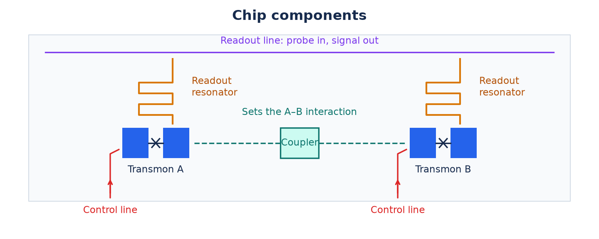
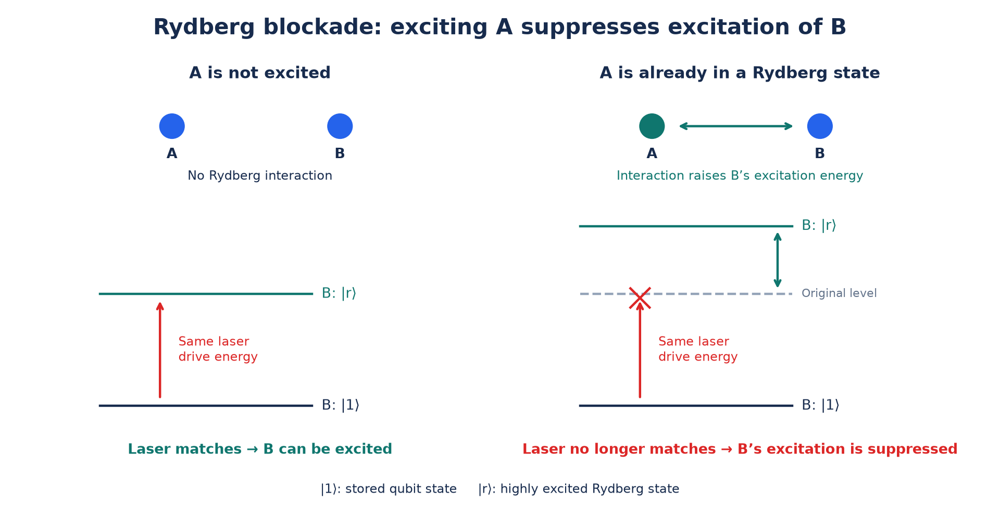

# Quantum computing hardware

Last updated: 2026-10-15

## Overview

A qubit can be in a superposition

$$
|\psi\rangle=\alpha|0\rangle+\beta|1\rangle,
\qquad \alpha,\beta\in\mathbb C,
\qquad |\alpha|^2+|\beta|^2=1.
$$

The amplitudes set the measurement probabilities, $P(0)=|\alpha|^2$ and $P(1)=|\beta|^2$. Their **relative phase**, $\arg\beta-\arg\alpha$, determines how the two components interfere during later gates.

**Atoms and ions provide discrete internal energy levels for qubits.** For two chosen levels with energies $E_0$ and $E_1$, a superposition evolves as

$$
\begin{aligned}
|\psi(t)\rangle
&=\alpha e^{-iE_0t/\hbar}|0\rangle
+\beta e^{-iE_1t/\hbar}|1\rangle\\
&=e^{-iE_0t/\hbar}
\left(\alpha|0\rangle+\beta e^{-i\Delta E\,t/\hbar}|1\rangle\right),
\qquad \Delta E=E_1-E_0.
\end{aligned}
$$

Here $\hbar=h/(2\pi)$, with $h$ Planck's constant. The common **global phase** $e^{-iE_0t/\hbar}$ does not affect measurement probabilities. The energy difference changes the relative phase:

$$
\varphi(t)=\varphi(0)-\frac{\Delta E\,t}{\hbar}.
$$

A resonant electromagnetic drive couples the levels to prepare a superposition. **Electron spins** follow the same description when a magnetic field gives spin up and spin down different energies.

**Qubits need protection from their surroundings.** Collisions, fluctuating fields, and uncontrolled motion can exchange energy or disturb relative phase. Interference is lost when the environment acquires information that distinguishes the superposition’s components. This is **decoherence**. Cooling reduces thermal excitation and motion. Vacuum, shielding, and stable fields reduce other disturbances.

**Hardware must protect qubits while allowing control and readout.** This requires two addressable states, suppression of unwanted interactions, and controlled coupling. A gate-based computer needs scalable, well-characterized qubits, reliable initialization, universal gates, individual measurement, and coherence lasting long enough to use them. These are the five **DiVincenzo criteria**.

### Relaxation and phase stability

Two time scales, **$T_1$** and **$T_2$**, describe how populations and phase information survive.

On the Bloch sphere, the north and south poles represent $|0\rangle$ and $|1\rangle$. Height encodes the population difference, and angle around the vertical axis encodes relative phase. Noise can shorten the vector, moving its tip inside the sphere.

| Time scale | Physical change | Bloch-sphere picture |
| --- | --- | --- |
| $T_1$: population relaxation | Population imbalance relaxes toward equilibrium. | For relaxation to the ground state, the vector approaches the north pole. |
| $T_2$: loss of phase coherence | Phase fluctuations wash out interference across repeated runs. Energy relaxation also contributes. | The component in the equatorial plane shrinks. Pure phase noise leaves the height unchanged. |

Relaxation can approach a mixture of zero and one, as in hyperfine ground-state encodings. For relaxation toward $|0\rangle$ with exponential decay,

$$
p_1(t)=p_1(0)e^{-t/T_1},
\qquad
r_\perp(t)=r_\perp(0)e^{-t/T_2},
$$

Here $p_1$ is the probability of one, and $r_\perp$ is the length of the Bloch vector’s projection onto the equatorial plane. Compare $T_1$ and $T_2$ with gate and idle times to estimate information loss during a circuit.

*Figure 1. Starting from $|+\rangle$, relaxation moves the average Bloch vector toward $|0\rangle$. Pure phase noise shrinks it without changing populations. Colours show successive times.*

## Hardware platforms

Qubits can be encoded in superconducting circuit levels, atomic states, semiconductor spins, or photons. Each platform supplies different controls, interactions, and noise sources.

Superconducting qubits, trapped ions, and neutral atoms illustrate three prominent approaches: electrical circuits, ions coupled through shared motion, and rearrangeable atom arrays. These interactions determine native gates and connectivity.

## Superconducting qubits

A **Josephson junction** has two superconductors separated by a thin insulating barrier. Coherent Cooper-pair tunnelling makes it a **nonlinear inductor**. In parallel with a large capacitor, it forms a transmon's **anharmonic oscillator**. The circuit has discrete quantum energy levels. The ground level is $|0\rangle$ and the first excited level is $|1\rangle$.

The junction's nonlinearity makes successive gaps unequal:

$$
E_1-E_0\ne E_2-E_1.
$$

A pulse tuned to the lowest transition can therefore control the qubit while limiting excitation of $|2\rangle$. Population outside the qubit levels is **leakage**.

*Figure 2. A junction and capacitor form a transmon. Unequal energy gaps let a microwave pulse address the two qubit levels while limiting excitation of the next level.*

Picture a chip patterned with transmons, readout resonators, couplers, and control lines. It sits at the coldest stage of a dilution refrigerator. Cooling to tens of millikelvin suppresses thermal excitation. Low-loss materials, shielding, and filtered control lines reduce energy exchange and phase noise. Defects, stray radiation, and crosstalk remain error sources.

A **readout resonator** is often a winding transmission line supporting a microwave mode. Its response depends on the transmon’s state, allowing zero and one to be distinguished. A **3D cavity** supports a similar mode inside a metal enclosure. **Control lines** carry gate pulses, and **readout lines** carry probe and measurement signals.

*Figure 3. Control lines deliver gates, resonators reveal qubit states, and the coupler connects the two qubits.*

The resonant frequency is $f_{01}=(E_1-E_0)/h$, typically **a few gigahertz**. A resonant **microwave pulse** drives this transition. In the frame rotating at $f_{01}$, pulse phase selects the rotation axis in the $X$–$Y$ plane. Strength and duration set the angle.

- **$X$:** choose the $X$-axis phase and a calibrated $\pi$ pulse. It swaps zero and one, up to global phase.
- **$Y$:** use the same rotation angle with drive phase shifted by $\pi/2$.
- **$Z$:** update the tracked phase frame by $\pi$ and adjust subsequent controls. This **virtual $Z$** implements $\alpha|0\rangle+\beta|1\rangle\to\alpha|0\rangle-\beta|1\rangle$ without a separate physical pulse.
- **Readout:** send a microwave probe through the readout resonator and classify the returning response as zero or one.

A **coupler** sets the interaction between qubits. It can be a capacitive or inductive connection, a coupling resonator, or a tunable circuit containing additional Josephson junctions. The interaction can exchange excitations or shift joint-state energies. A conditional phase of $\pi$ on $|11\rangle$, after compensating single-qubit phases, gives **$CZ$**. One implementation couples $|11\rangle$ to the nearby $|02\rangle$ level. Other designs favour exchange or ECR gates.

## Trapped ions

An **ion is an atom with a net electric charge**. Oscillating and static electric fields confine ions in vacuum. Each ion carries one qubit in two selected internal states. For a common $^{171}\mathrm{Yb}^{+}$ encoding,

$$
|0\rangle=|F=0,m_F=0\rangle,
\qquad
|1\rangle=|F=1,m_F=0\rangle.
$$

Both are **hyperfine states** in the electronic ground level. Their energy difference comes from coupling electron and nuclear angular momenta. $F$ labels their combined angular momentum, and $m_F$ its projection along the field. Their populations can be long-lived.

Vacuum suppresses collisions, while stable fields and drive references protect phase. **Laser cooling** slows the ions through repeated photon absorption and emission. Cooling a second ion species also cools their shared motion without directly driving the qubit states. Unwanted light, microwave leakage, and motional heating remain error sources.

**Optical pumping** repeatedly excites other states until decay leaves the ion in zero. Focused beams address individual ions, or electrodes move selected ions into a control zone. A **Raman drive** uses two laser frequencies whose difference matches the qubit splitting. Their relative phase selects the $X$–$Y$ axis, and pulse strength and duration set the rotation angle.

- **$X$:** apply an addressed Raman $\pi$ pulse with the phase defining the $X$ axis.
- **$Z$:** update the tracked phase frame, or shift the two levels differently with light to accumulate a relative phase of $\pi$.
- **Readout:** illuminate a state-selective optical transition and use photon counts to distinguish bright and dark states.

Electric repulsion couples the ions' motion into shared vibrational modes. State-dependent laser forces couple selected qubits to those modes. A pulse sequence applies an entangling gate and returns the motion to its initial state. This produces **$XX$ or $ZZ$ interactions**, with the spin axis set by controls or basis rotations. A $ZZ$ interaction gives $R_{ZZ}(\theta)=e^{-i\theta Z\otimes Z/2}$.

Shared modes let different pairs interact. Segmented traps also move ions between storage and gate zones, whose number limits parallel operations.

*Figure 4. Electric fields hold the ions. Drives control their internal states, and shared motion carries the interaction needed for two-qubit gates.*

## Neutral atoms

A **neutral atom has no net electric charge**. An **optical tweezer**, a tightly focused laser beam, holds it in vacuum. The light’s electric field induces a dipole by slightly displacing the electron cloud relative to the nucleus. At a suitable frequency, this interaction lowers the atom’s potential energy most at the focus, pulling it toward the centre. An array of spots holds an array of atoms.

For example, two ground-state hyperfine levels of $^{87}\mathrm{Rb}$ can encode

$$
|0\rangle=|F=1,m_F=0\rangle,
\qquad
|1\rangle=|F=2,m_F=0\rangle.
$$

These hyperfine states differ in how electron and nuclear angular momenta combine. Both remain in the same trap and electronic ground level. A drive prepares their superposition.

*Figure 5. The laser focus traps the atom. Internal levels store zero and one, while a temporary Rydberg excitation enables interactions with neighbours.*

Vacuum suppresses collisions, laser cooling reduces motion, and stable fields and trapping light limit phase noise. Trap-light scattering can change populations, intensity variations shift the levels, and atoms can be lost.

Optical pumping prepares zero. Control uses focused Raman beams or global microwave rotations combined with local light-induced energy shifts. Pulse strength and duration set the rotation angle, and drive phase selects the $X$–$Y$ axis. Steering the tweezers rearranges the atoms.

- **$X$:** drive the storage-state transition with a resonant $\pi$ pulse and the $X$-axis phase.
- **$Z$:** shift the two levels differently with focused light to accumulate a relative phase of $\pi$. Compatible controllers can also track phase-frame updates.
- **Readout:** use state-dependent fluorescence, or map the internal state to position or atom loss before imaging. Atom retention depends on the method.

Ground-state atoms interact weakly at typical tweezer separations. A laser temporarily couples a storage state to a highly excited **Rydberg state**, $|r\rangle$, with a widely spread electron cloud that enables strong interactions. Exciting one atom shifts the energy required to excite its neighbour. Under **Rydberg blockade**, that shift suppresses resonant excitation of the second atom.

A laser sequence uses this conditional response to apply **$CZ$** while returning population to the storage states. Moving atoms into range or addressing nearby atoms selects interacting pairs.

*Figure 6. Exciting A shifts the energy needed to excite B. The same laser drive then misses B’s transition, providing the conditional response used for two-qubit gates.*

## Comparison

| Platform | Qubit | Control and readout | Interaction and native gates | Advantages and limitations | Research directions |
| --- | --- | --- | --- | --- | --- |
| Superconducting | Two lowest transmon levels on a cold chip. | Microwaves, virtual $Z$, resonator readout. | Engineered couplings. $CZ$, ECR, or exchange gates. | Fast gates, but short memory and extra routing for distant pairs. | Cleaner materials, more accurate gates, chip connections, and error correction. |
| Trapped ions | Two internal ion states in an electric trap. | Raman or microwave drives, fluorescence readout. | Shared motion. $XX$/$ZZ$ gates, with pair access through shared modes or transport. | Longer memory, but gates, transport, and cooling consume time. | Faster gates, less heating during movement, more parallel gates, and error correction. |
| Neutral atoms | Two internal atom states in optical tweezers. | Raman/microwave drives, local light shifts, imaging. | Rydberg interactions. $CZ$ gates, with pair access through atom movement or beam addressing. | Large rearrangeable arrays. Movement, atom loss, and measurement/reset affect the schedule. | More accurate Rydberg gates, readout that keeps atoms, replacement of lost atoms, and error correction. |
