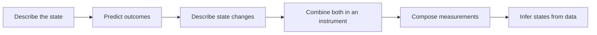

# Quantum theory of measurement

A quantum measurement produces a classical record and leaves a quantum system behind. Predicting the record requires a POVM; predicting the remaining system requires a state transformation. An instrument describes both. This distinction is the foundation for simulating measurements, noise, feedback, and error-correction checks.



## Learning path

Read the pages in order on a first pass. Each develops a physical question, works through an example, and ends with a check whose solution can be expanded. Try the check before reading its solution. Move on when you can explain the result and reproduce its main calculation; mark a confusing sentence or equation for our next discussion.

| Step | Question | What you should master |
| --- | --- | --- |
| [1. States and subsystems](states-and-subsystems.md) | What information describes the input? | Calculate with density matrices and partial traces; distinguish mixtures, superpositions, and entanglement. |
| [2. Effects and POVMs](effects-and-povms.md) | What results can the detector report? | Construct valid effects, calculate probabilities, and model classical readout errors. |
| [3. Operations and channels](operations-and-channels.md) | How can the quantum state change? | Apply Kraus maps, check channel validity, and understand complete positivity and Choi conventions. |
| [4. Instruments and apparatus](instruments-and-apparatus.md) | What state accompanies each result? | Sample branches, normalize conditional states, implement feedback, and connect an instrument to an ancilla circuit. |
| [5. Compatibility and disturbance](compatibility-and-disturbance.md) | What happens when measurements are combined? | Calculate sequential statistics and distinguish joint measurability, disturbance, and uncertainty. |
| [6. Tomography](tomography.md) | What can the recorded data tell us about the input? | Check informational completeness and reconstruct a qubit while accounting for sampling and measurement noise. |

Our running example is a tunable qubit $Z$ measurement. Its strength $\eta$ runs from zero information at $\eta=0$ to a sharp measurement at $\eta=1$. We first specify its probabilities, then choose a physical state update, implement it with an ancilla, follow it with another measurement, and measure fresh copies to estimate a state. The choice of state update matters: probabilities alone do not fix disturbance.

## How deeply to learn the mathematics

**Calculate and implement:** density matrices, tensor products, partial trace, Born probabilities, Kraus maps, conditional updates, feedback, sequential measurements, and qubit tomography. Work through the small matrices by hand at least once, then reproduce them in code.

**Explain and use:** complete positivity, Choi matrices, Naimark and Stinespring dilation, compatibility, and informational completeness. Know what each guarantees and how it affects a software design. Reproducing the general existence and uniqueness proofs is optional for this path.

**Recognize and revisit when needed:** Hilbert-space completeness, trace-class operators, continuous-outcome measures, unbounded operators, and phase-space measurements. These become central for bosonic and continuous-variable work; the finite-dimensional formulas here do not replace their domain and convergence requirements.

## Course map and notation

These notes follow *Quantum theory of measurement*, corrected course notes dated November 15, 2024, supplied as `QMcontinue-4.pdf`. Page references are printed page numbers. The source PDF is kept outside this repository. The notes explain the material independently and use Dirac notation for familiarity; the course often writes vectors without kets and uses $K^*$ where we write $K^\dagger$.

| Course section | Where it enters this path |
| --- | --- |
| Opening of Chapter 1; §§1.1–1.1.2, pp. 7–16 | States, effects, linearity, composite systems, and the Hilbert-space viewpoint in page 1 |
| §§1.2–1.2.3, pp. 17–26 | POVMs, Naimark dilation, moments, and post-processing in page 2 |
| §§1.3–1.3.1, pp. 26–34 | Operations, channels, Kraus, Choi, and Stinespring in page 3 |
| §§1.4–1.5.1, pp. 34–47 | Probe models, von Neumann measurement, instruments, and dilation in page 4 |
| §2.1, including phase space, pp. 53–67 | Joint measurements in page 5 |
| §2.2, including sequential position and momentum, pp. 67–77 | Sequential measurements and disturbance in page 5 |
| §2.3, pp. 77–83 | Preparation and measurement uncertainty in page 5 |
| §2.4, pp. 83–90 | State reconstruction and informational completeness in page 6 |
| §§1.6 and 2.5; Chapter 3 appendices | Further exercises and proofs after the corresponding topic |

We use $I$ for the identity matrix, $X,Y,Z$ for the Pauli matrices, and $\rho$ for a density matrix. Measurement outcomes are $s\in\{+1,-1\}$ unless stated otherwise. Probabilities describe repeated identical preparations, not repeated measurements on one evolving system.

## Run the example

The [NumPy example](measurement_lab.py) implements the running instrument, an ancilla realization, conditional feedback, a parity check, sequential measurements, and qubit tomography. From the repository root, run:

```bash
uv run python qec_knowledge_base/quantum-theory-of-measurement/measurement_lab.py
```

It can also run with any Python environment containing NumPy. Read through page 4 before using the entire script. The assertions check mathematical identities, and the seeded sampling example illustrates finite-shot fluctuations. Dense density matrices are useful for learning and small systems; their storage grows as $4^n$ for $n$ qubits.

Start with [States and subsystems](states-and-subsystems.md).

Last updated: 2026-11-09
